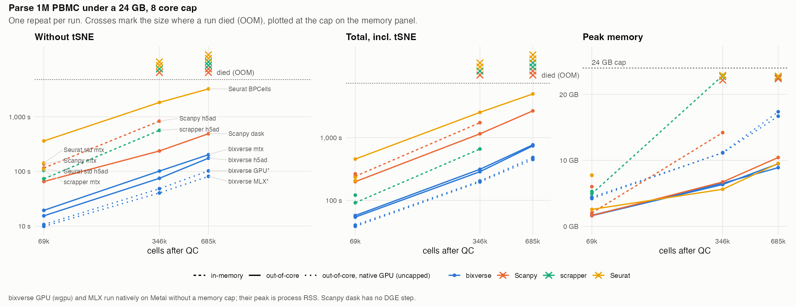

# single-cell-benchmark

## Description

How far do the big single cell frameworks get on a MacBook Air class machine?
The Parse Biosciences 1M PBMC data set (987,585 cells), random 100k and 500k
subsamples, the same ten step workflow in every framework (load, QC,
normalise, HVG, PCA, Harmony, kNN/sNN, Leiden, UMAP, tSNE), in Docker capped at
24 GB and 8 cores to mimic a small laptop situation. The benchmarks here were
run within Docker on a MacBook M1 Max.

## Headline



Seconds from load to UMAP (tSNE excluded) and peak memory, or where the run
died. One repeat each.

| framework | 100k | 500k | full |
|---|---|---|---|
| bixverse mtx | 24 s, 1.6 GB | 149 s, 6.3 GB | 280 s, 10.6 GB |
| bixverse h5ad | 21 s, 1.6 GB | 111 s, 6.5 GB | 233 s, 9.0 GB |
| bixverse GPU (native)* | 13 s, 4.3 GB | 62 s, 10.0 GB | 124 s, 16.1 GB |
| Scanpy mtx | 93 s, 6.8 GB | OOM at load | OOM at load |
| Scanpy h5ad | 76 s, 2.6 GB | 297 s, 14.2 GB | OOM at load |
| Scanpy dask | 74 s, 1.9 GB | 294 s, 6.8 GB | 629 s, 9.5 GB |
| scrapper mtx | 102 s, 5.3 GB | OOM at load | OOM at load |
| scrapper h5ad | 65 s, 4.8 GB | 519 s, 22.7 GB | OOM at load |
| Seurat std mtx | 185 s, 8.7 GB | OOM at load | OOM at load |
| Seurat std h5ad | 144 s, 8.7 GB | OOM at load | OOM at load |
| Seurat BPCells | 200 s, 1.7 GB | 1092 s, 5.3 GB | 2303 s, 9.4 GB |
| OSCA HDF5 | 807 s, 22.7 GB | OOM (worker) at hvg | OOM (worker) at hvg |

\* Native macOS on Metal, no memory cap, peak is process RSS: not comparable to
the Docker rows!

- **Only the out-of-core designs finish the full data set.** bixverse (3.9 min
  from h5ad, 2.1 min on the GPU), Scanpy with Dask (10.5 min) and Seurat with
  BPCells (38 min), all at 9 to 11 GB. Every in-memory path dies at load;
  OSCA's HDF5 path dies in HVG.
- **Each design pays somewhere.** bixverse converts up front into two on-disk
  views, then runs fast kernels. Dask loads fast but re-reads the file on every
  forced pass and uses stock in-memory UMAP and Harmony. BPCells re-evaluates
  its lazy chain on every pass (PCA 703 s, UMAP 749 s on the full data).
- **Against in-memory Scanpy** at 500k, the largest size it survives, bixverse
  from h5ad is 2.7x faster at under half the memory.
- **scrapper is the fastest in-memory tool** (65 s at 100k) and wins QC, HVG
  and default tSNE, but its in-memory path runs out of room by 500k.
- **tSNE dominates every run that has it.** Drop it for large data.

## Caveats

- One repeat, one machine (M1 Max under Docker, VM limit ~23.4 GB plus ~4 GB
  swap), timings only: no quality metrics yet.
- Defaults differ between frameworks (scaling before PCA, normalisation, graph
  construction), so cluster counts do not compare.
- Two harness workarounds: Scanpy Dask computes its QC sums by hand, because
  `calculate_qc_metrics` blows up under Dask; OSCA runs its documented
  parallel path, which OOMs, and serial HVG was too slow to finish.
- The benchmark is written by bixverse's author.

Details in [methods](docs/methods.md).

## Docs

- [Results](docs/results.md): per-step tables for every size, and what they
  show.
- [Methods](docs/methods.md): setup, versions, workflow parameters, full
  caveats, how to run.
- [bixverse across versions](docs/bixverse-versions.md): 0.5.2 to 0.5.4 on the
  same workflow, and open items.

## Running it

```bash
uv run scripts/subsample.py ~/Desktop/parse_pbmc_1m data/parse_100k 100000
uv run scripts/to_h5ad.py data/parse_100k
docker build -f docker/r.Dockerfile -t scbench-r .
docker build -f docker/py.Dockerfile -t scbench-py .
scripts/run.sh <tool> parse_100k       # bixverse | scanpy | scrapper | seurat_standard | seurat_bpcells | osca
uv run scripts/tables.py --summary results
```

Options and the native GPU run: [methods](docs/methods.md#running-it).
