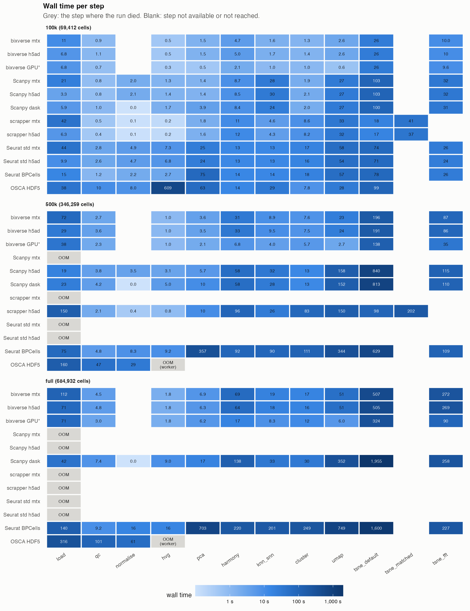

# Results

Seconds per step, one repeat each. **OOM** marks the step where the container
was killed; **OOM (worker)** where a forked BiocParallel worker was. Peak GB is
cgroup anon memory; the bixverse GPU row is native macOS RSS and not comparable.
Setup and caveats: [methods](methods.md).

Regenerate with `uv run scripts/tables.py results`.

## 100k cells (69,412 after QC)

| step | bixverse mtx | bixverse h5ad | bixverse GPU (native) | Scanpy mtx | Scanpy h5ad | Scanpy dask | scrapper mtx | scrapper h5ad | Seurat std mtx | Seurat std h5ad | Seurat BPCells | OSCA HDF5 |
|---|---|---|---|---|---|---|---|---|---|---|---|---|
| load | 11.1 | 6.9 | 6.1 | 21.4 | 3.3 | 5.9 | 42.5 | 6.3 | 43.6 | 9.9 | 14.4 | 38.2 |
| qc | 1.0 | 1.1 | 0.7 | 0.8 | 0.8 | 1.0 | 0.5 | 0.4 | 2.8 | 2.6 | 1.2 | 10.0 |
| normalise | n/a | n/a | n/a | 2.0 | 2.1 | 0.0 | 0.1 | 0.1 | 4.9 | 4.7 | 2.0 | 8.0 |
| hvg | 0.4 | 0.5 | 0.3 | 1.3 | 1.4 | 1.7 | 0.2 | 0.2 | 7.3 | 6.8 | 2.6 | 609.2 |
| pca | 1.5 | 1.5 | 0.5 | 1.4 | 1.5 | 3.9 | 1.8 | 1.6 | 24.5 | 24.0 | 73.4 | 63.4 |
| harmony | 4.9 | 4.9 | 2.1 | 8.7 | 8.5 | 8.5 | 11.1 | 12.1 | 13.4 | 13.0 | 13.6 | 13.9 |
| knn_snn | 1.7 | 1.7 | 0.9 | 28.3 | 29.6 | 23.6 | 4.6 | 4.3 | 13.5 | 13.0 | 14.1 | 28.5 |
| cluster | 1.4 | 1.4 | 1.0 | 1.9 | 2.1 | 2.0 | 8.6 | 8.1 | 17.2 | 16.3 | 18.4 | 7.8 |
| umap | 2.5 | 2.5 | 0.6 | 27.3 | 26.7 | 26.9 | 32.8 | 32.3 | 58.1 | 54.2 | 56.2 | 27.8 |
| tsne_default | 26.1 | 25.9 | 23.9 | 102.9 | 103.1 | 99.5 | 18.2 | 16.5 | 74.4 | 70.9 | 73.9 | 98.9 |
| tsne_matched | n/a | n/a | n/a | n/a | n/a | n/a | 41.5 | 36.9 | n/a | n/a | n/a | n/a |
| tsne_fft | 8.5 | 8.2 | 4.4 | 32.3 | 31.7 | 30.7 | n/a | n/a | 25.8 | 24.0 | 23.9 | n/a |
| **total** | **59** | **55** | **40** | **228** | **211** | **204** | **162** | **119** | **286** | **239** | **294** | **906** |
| total without tSNE | 25 | 20 | 12 | 93 | 76 | 74 | 102 | 65 | 185 | 144 | 196 | 807 |
| **peak GB** | **1.6** | **1.7** | **4.2** | **6.8** | **2.6** | **1.9** | **5.3** | **4.8** | **8.7** | **8.7** | **1.9** | **22.7** |
| peak swap GB | 0.0 | 0.0 | 0.0 | 0.0 | 0.0 | 0.0 | 0.0 | 0.0 | 0.0 | 0.0 | 0.0 | 3.7 |

## 500k cells (346,259 after QC)

| step | bixverse mtx | bixverse h5ad | bixverse GPU (native) | Scanpy mtx | Scanpy h5ad | Scanpy dask | scrapper mtx | scrapper h5ad | Seurat std mtx | Seurat std h5ad | Seurat BPCells | OSCA HDF5 |
|---|---|---|---|---|---|---|---|---|---|---|---|---|
| load | 73.2 | 30.6 | 31.2 | **OOM** | 19.0 | 23.3 | **OOM** | 150.3 | **OOM** | **OOM** | 71.6 | 159.5 |
| qc | 2.8 | 3.3 | 2.2 | - | 3.8 | 4.2 | - | 2.1 | - | - | 4.7 | 47.2 |
| normalise | n/a | n/a | n/a | - | 3.5 | 0.0 | - | 0.4 | - | - | 8.3 | 29.3 |
| hvg | 1.0 | 1.1 | 0.9 | - | 3.1 | 5.0 | - | 0.9 | - | - | 8.8 | **OOM (worker)** |
| pca | 3.5 | 3.5 | 2.0 | - | 5.7 | 10.3 | - | 10.2 | - | - | 358.0 | - |
| harmony | 31.1 | 33.2 | 6.9 | - | 58.3 | 58.4 | - | 95.6 | - | - | 92.0 | - |
| knn_snn | 8.8 | 9.3 | 4.2 | - | 32.3 | 27.7 | - | 26.2 | - | - | 94.1 | - |
| cluster | 7.8 | 7.9 | 5.9 | - | 13.4 | 12.9 | - | 83.2 | - | - | 113.3 | - |
| umap | 21.3 | 21.5 | 2.7 | - | 158.0 | 152.4 | - | 149.8 | - | - | 340.0 | - |
| tsne_default | 156.0 | 153.6 | 134.2 | - | 840.4 | 813.0 | - | 98.3 | - | - | 639.4 | - |
| tsne_matched | n/a | n/a | n/a | n/a | n/a | n/a | - | 202.2 | n/a | n/a | n/a | n/a |
| tsne_fft | 39.9 | 40.3 | 18.7 | - | 114.9 | 110.1 | n/a | n/a | - | - | 108.4 | n/a |
| **total** | **345** | **304** | **209** | failed | **1252** | **1217** | failed | **819** | failed | failed | **1838** | failed |
| total without tSNE | 150 | 110 | 56 | failed | 297 | 294 | failed | 519 | failed | failed | 1091 | failed |
| **peak GB** | **6.3** | **6.5** | **10.0** | **22.3** | **14.2** | **6.8** | **22.7** | **22.7** | **22.7** | **22.8** | **5.5** | **22.7** |
| peak swap GB | 0.0 | 0.0 | 0.0 | 3.9 | 0.0 | 0.0 | 3.8 | 3.2 | 3.7 | 3.5 | 0.0 | 3.7 |

bixverse CPU tSNE builds its kNN with IVF at this size (kmknn at 100k);
kmknn runs are in `results/archive_tsne_kmknn`.

## Full data set (684,932 after QC)

| step | bixverse mtx | bixverse h5ad | bixverse GPU (native) | Scanpy mtx | Scanpy h5ad | Scanpy dask | scrapper mtx | scrapper h5ad | Seurat std mtx | Seurat std h5ad | Seurat BPCells | OSCA HDF5 |
|---|---|---|---|---|---|---|---|---|---|---|---|---|
| load | 148.2 | 77.9 | 74.0 | **OOM** | **OOM** | 42.3 | **OOM** | **OOM** | **OOM** | **OOM** | 142.7 | 315.6 |
| qc | 4.5 | 4.9 | 2.9 | - | - | 7.4 | - | - | - | - | 9.5 | 101.4 |
| normalise | n/a | n/a | n/a | - | - | 0.0 | - | - | - | - | 16.5 | 61.0 |
| hvg | 1.8 | 1.8 | 1.8 | - | - | 9.0 | - | - | - | - | 16.1 | **OOM (worker)** |
| pca | 6.3 | 6.2 | 5.6 | - | - | 17.2 | - | - | - | - | 702.3 | - |
| harmony | 64.9 | 62.9 | 16.4 | - | - | 137.8 | - | - | - | - | 213.1 | - |
| knn_snn | 17.5 | 17.8 | 8.3 | - | - | 33.1 | - | - | - | - | 201.0 | - |
| cluster | 15.6 | 15.7 | 11.7 | - | - | 29.9 | - | - | - | - | 249.6 | - |
| umap | 47.9 | 50.9 | 6.0 | - | - | 352.1 | - | - | - | - | 759.5 | - |
| tsne_default | 372.8 | 371.3 | 324.6 | - | - | 1955.3 | - | - | - | - | 1645.1 | - |
| tsne_fft | 120.7 | 124.7 | 39.5 | - | - | 258.4 | n/a | n/a | - | - | 228.9 | n/a |
| **total** | **800** | **734** | **491** | failed | failed | **2843** | failed | failed | failed | failed | **4184** | failed |
| total without tSNE | 307 | 238 | 127 | failed | failed | 629 | failed | failed | failed | failed | 2310 | failed |
| **peak GB** | **9.8** | **8.9** | **15.6** | **22.5** | **22.5** | **9.5** | **22.8** | **22.8** | **22.8** | **22.8** | **9.7** | **22.8** |
| peak swap GB | 0.0 | 0.1 | 0.0 | 3.7 | 3.2 | 0.0 | 3.5 | 3.0 | 3.4 | 3.0 | 0.0 | 3.6 |

bixverse CPU tSNE builds its kNN with IVF at this size (kmknn at 100k);
kmknn runs are in `results/archive_tsne_kmknn`.

## Warm start

Reconnecting to data a cold run already converted (`WARM=1 scripts/run.sh`),
load step only. bixverse reopens its two views and the stored cell map, so its
object holds the post-QC cells; BPCells reopens the pre-filtered, pre-QC matrix
and builds the Seurat object. Each warm run goes straight after its cold run,
so the files are likely still in the page cache. Warm peak GB is the load only;
cold load s is the load step of the full cold run.

| size | framework | cold load s | warm load s | warm peak GB |
|---|---|---|---|---|
| 100k | bixverse | 11.1 | 0.3 | 0.2 |
| 100k | Seurat BPCells | 14.4 | 2.3 | 0.8 |
| 500k | bixverse | 73.2 | 0.6 | 0.3 |
| 500k | Seurat BPCells | 71.6 | 10.4 | 0.9 |
| full | bixverse | 148.2 | 2.3 | 0.5 |
| full | Seurat BPCells | 142.7 | 20.8 | 1.1 |

## What it shows

- **Three frameworks finish the full data set, all out-of-core.** Without
  tSNE: bixverse 4.0 min from h5ad (5.1 min from mtx, 2.1 min on the GPU),
  Scanpy Dask 10.5 min, Seurat + BPCells 38.5 min. Everything that holds the
  counts in memory dies at load, and OSCA's HDF5 path dies in HVG.
- **Memory is now a tie among the survivors.** Full data peaks: bixverse 8.9
  GB (h5ad) and 9.8 GB (mtx), Scanpy Dask 9.5 GB, Seurat + BPCells 9.7 GB.
- **Each out-of-core design pays somewhere else.** bixverse pays up front to
  convert into its two views (78 s from h5ad on the full data) and is fast
  after. Dask loads in 42 s but re-reads the file on every forced pass, and
  its UMAP (352 s) and Harmony (138 s) are the stock in-memory ones. BPCells
  re-evaluates its lazy chain on every pass (PCA 702 s, UMAP 760 s).
- **Against baseline in-memory Scanpy** at 500k, the largest size it survives:
  bixverse from h5ad is 2.7x faster without tSNE (110 s against 297 s) at under
  half the memory (6.5 GB against 14.2 GB). Scanpy only wins the load.
- **scrapper is fast wherever it stays in C++.** Best QC, HVG and default tSNE
  at 100k, but the loaders, the R harmony package and a UMAP that rebuilds the
  kNN cost it, and the in-memory path runs out of room at 500k from mtx.
- **A warm start removes the conversion cost.** On the full data bixverse
  reconnects in 2.3 s at 0.5 GB (148 s cold from mtx, 78 s from h5ad), and
  Seurat + BPCells in 20.8 s at 1.1 GB (143 s cold). At 500k: 0.6 s against
  10.4 s. So the up-front conversion bixverse pays is a one-off per data set:
  the load was 78 s of its 238 s without tSNE from h5ad. BPCells' warm load
  grows with the data (2.3, 10.4, 20.8 s); where that time goes is not timed.
  The BPCells PCA and UMAP cost above is untouched by a warm start.
- **Exact kNN inside tSNE does not scale.** kmknn took 49 s of the 78 s
  `tsne_fft` at 500k and 182 s of 258 s on the full data. IVF cuts that to 12 s
  and 45 s, and `tsne_fft` to 40 s and 121 s (mtx). IVF recall against kmknn
  is not measured here.
- **The GPU earns its keep from 500k.** 56 s without tSNE at 500k and 127 s on
  the full data. tSNE is now most of every run that has it (three-kernel FFT on the GPU: 19
  s at 500k, 40 s on the full data, against 40 s and 121 s for `fft_3k` on the CPU
  with an IVF kNN), so dropping it from a large-data workflow
  is the smart call.
