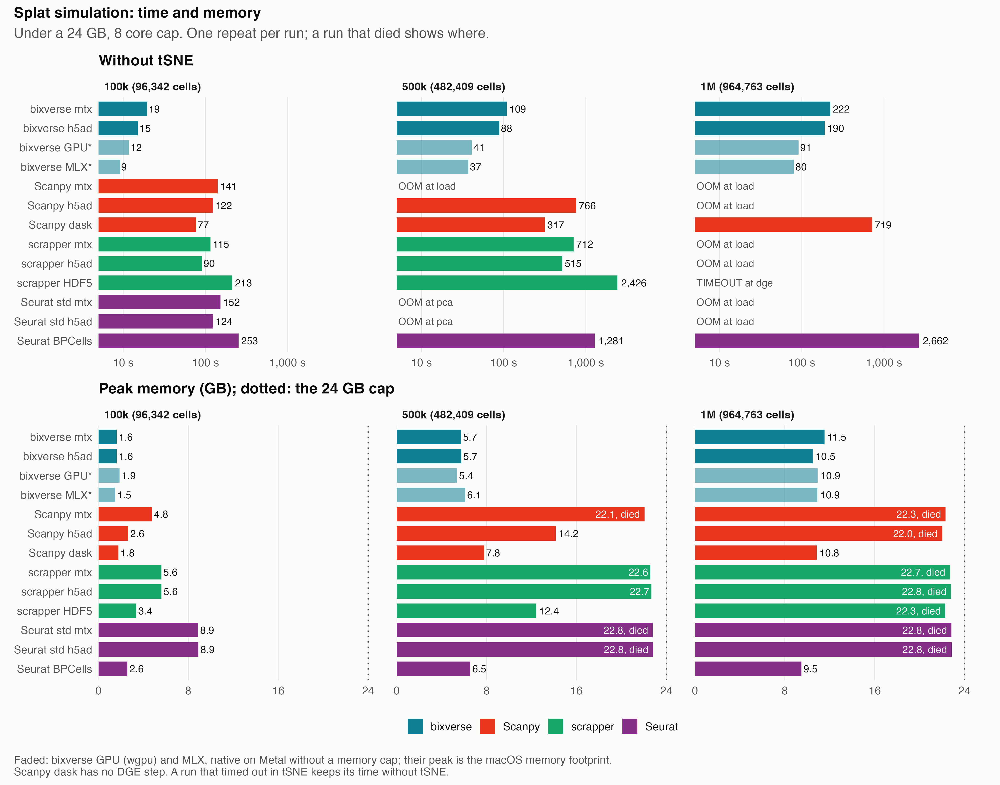
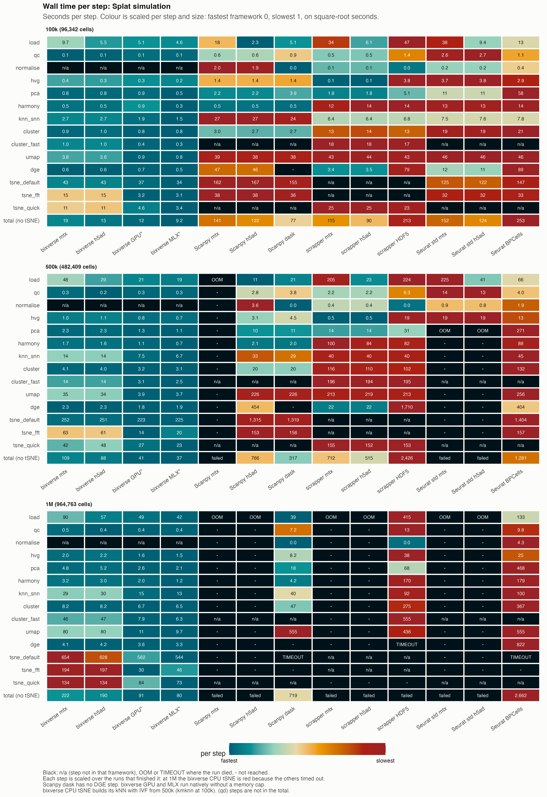
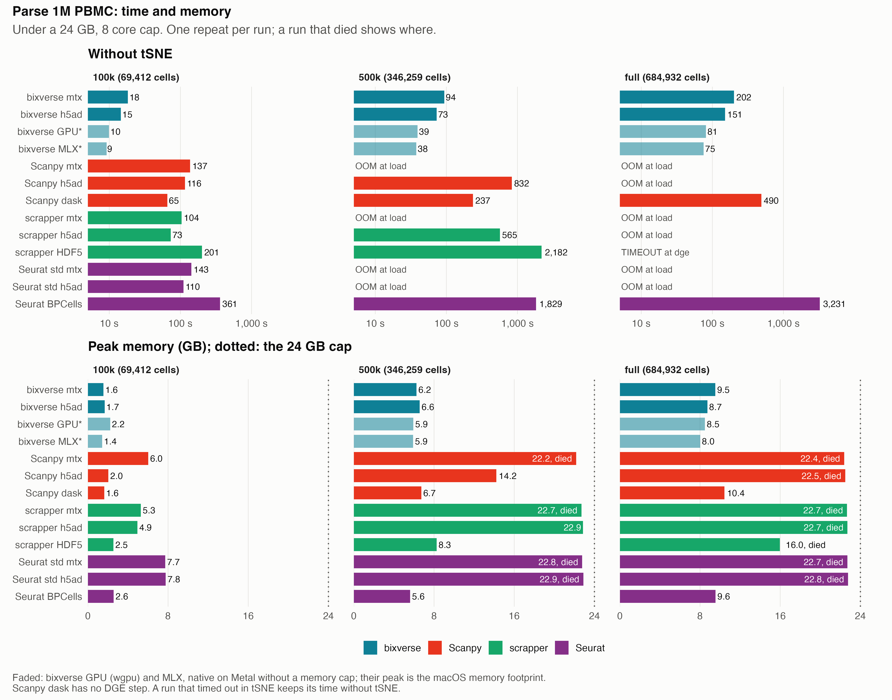
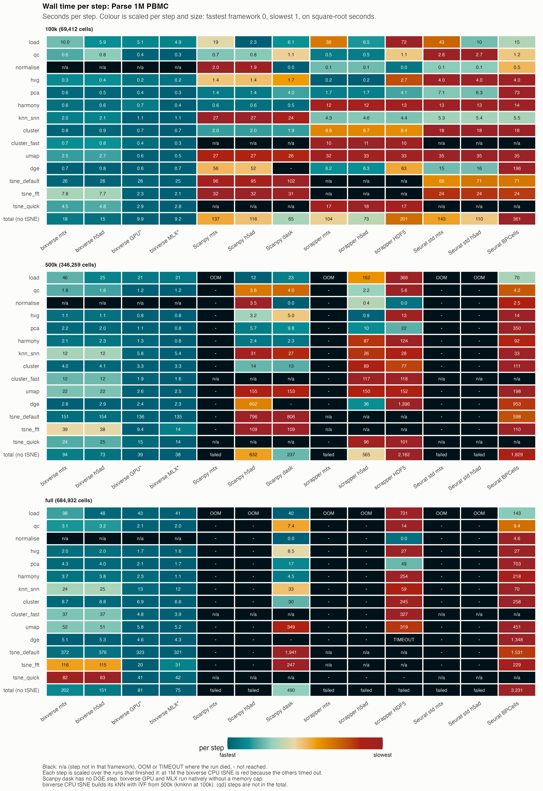
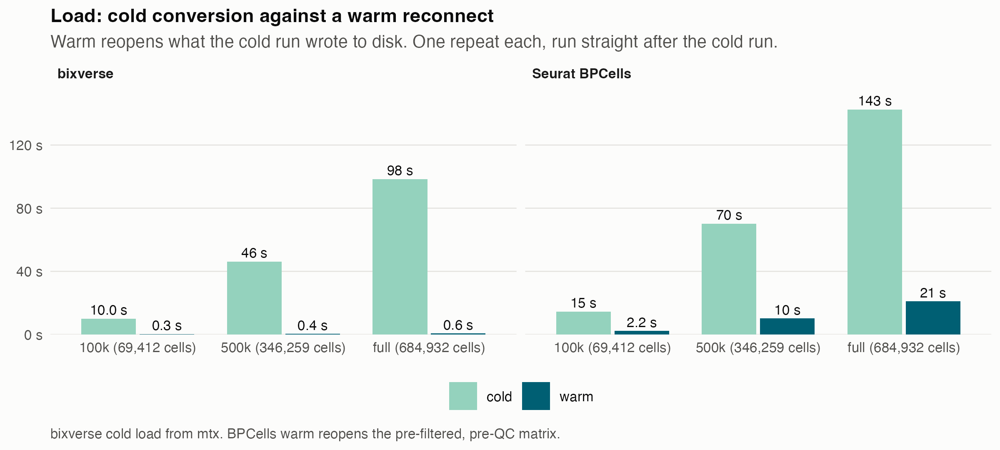
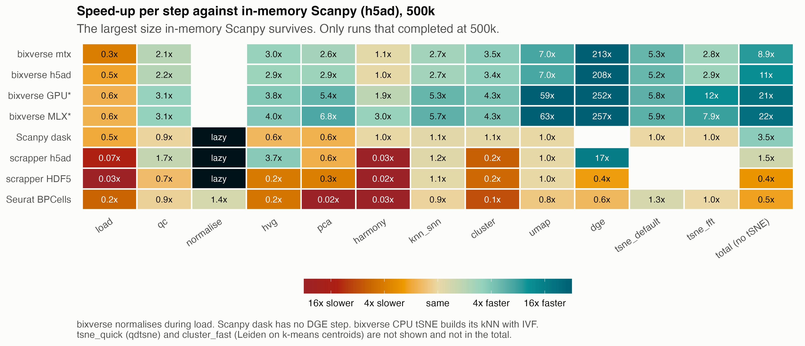
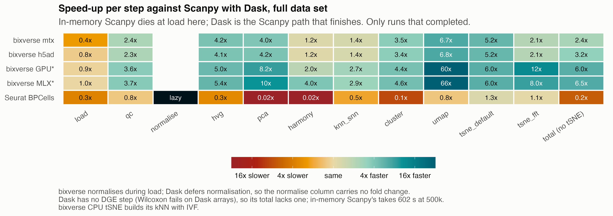

# Results

Seconds per step, one repeat each. **OOM** marks the step where the container
was killed; **TIMEOUT** where no step finished for 45 min. Peak GB is cgroup
anon memory over the whole run, tSNE included; the bixverse GPU and MLX
columns (\*) are the native macOS peak memory footprint, close to but not
the same metric. On-disk store GB is what
a run leaves in its scratch volume. Setup, versions and caveats:
[methods](methods.md).

Regenerate the timing tables with `uv run scripts/tables.py results <dataset>`
and the quality scores with `uv run scripts/score.py results/<dataset> data/<dataset>`.

qd: quick and dirty. `tsne_quick` is the qdtsne Barnes-Hut (theta 1, 500
iterations, depth-capped tree), not a standard Barnes-Hut tSNE.
`cluster_fast` is Leiden on k-means centroids, labels handed back to the
cells. Neither counts towards the totals.

Scanpy dask has no DGE step (Wilcoxon fails on Dask arrays), so its totals
miss the step that costs in-memory Scanpy 46 to 602 s. It is an experimental
path; see [methods](methods.md#caveats).

## Simulation

Splat data with 24 batches, 12 groups and uneven group composition per batch,
fitted to the PBMC data ([methods](methods.md#data)). Stack: bixverse 0.8.1,
bixverse.gpu 0.6.1, manifoldsR 0.5.0, Scanpy 1.12.4, scrapper 1.6.3, Seurat
5.6.0.

### 100k cells (96,342 after QC)

| step | bixverse mtx | bixverse h5ad | bixverse GPU* | bixverse MLX* | Scanpy mtx | Scanpy h5ad | Scanpy dask | scrapper mtx | scrapper h5ad | scrapper HDF5 | Seurat std mtx | Seurat std h5ad | Seurat BPCells |
|---|---|---|---|---|---|---|---|---|---|---|---|---|---|
| load | 9.7 | 5.4 | 5.1 | 4.6 | 17.8 | 2.3 | 5.1 | 34.4 | 6.1 | 47.1 | 37.9 | 9.4 | 13.3 |
| qc | 0.1 | 0.1 | 0.2 | 0.1 | 0.6 | 0.6 | 0.9 | 0.5 | 0.5 | 1.4 | 2.6 | 2.7 | 1.1 |
| normalise | n/a | n/a | n/a | n/a | 2.0 | 1.9 | 0.0 | 0.1 | 0.1 | 0.0 | 0.2 | 0.2 | 0.4 |
| hvg | 0.4 | 0.3 | 0.3 | 0.2 | 1.4 | 1.4 | 1.4 | 0.1 | 0.1 | 3.8 | 3.7 | 3.8 | 2.9 |
| pca | 0.8 | 0.8 | 0.9 | 0.5 | 2.2 | 2.2 | 3.9 | 1.8 | 1.8 | 5.1 | 10.6 | 10.6 | 58.3 |
| harmony | 0.5 | 0.5 | 1.0 | 0.3 | 0.5 | 0.5 | 0.4 | 12.2 | 14.4 | 14.3 | 13.3 | 13.3 | 13.8 |
| knn_snn | 2.7 | 2.7 | 1.9 | 1.5 | 26.9 | 26.5 | 24.2 | 6.4 | 6.4 | 6.7 | 7.5 | 7.6 | 7.8 |
| cluster | 0.9 | 1.0 | 0.8 | 0.8 | 3.0 | 2.7 | 2.7 | 13.2 | 13.9 | 12.6 | 19.0 | 19.3 | 20.7 |
| cluster_fast (qd) | 1.0 | 1.0 | 0.4 | 0.4 | n/a | n/a | n/a | 17.5 | 17.5 | 17.3 | n/a | n/a | n/a |
| umap | 3.8 | 3.6 | 0.9 | 0.8 | 39.0 | 37.7 | 37.8 | 43.1 | 43.6 | 43.0 | 45.7 | 46.3 | 46.3 |
| dge | 0.6 | 0.6 | 0.7 | 0.5 | 47.4 | 46.1 | - | 3.4 | 3.5 | 79.3 | 11.8 | 10.8 | 88.7 |
| tsne_default | 43.3 | 42.8 | 37.4 | 34.2 | 161.7 | 167.1 | 154.7 | n/a | n/a | n/a | 125.1 | 122.4 | 146.7 |
| tsne_fft | 14.6 | 14.8 | 3.2 | 3.1 | 37.8 | 38.4 | 35.8 | n/a | n/a | n/a | 31.6 | 31.6 | 32.9 |
| tsne_quick (qd) | 10.8 | 11.2 | 4.6 | 3.4 | n/a | n/a | n/a | 25.1 | 24.8 | 23.5 | n/a | n/a | n/a |
| **total** | **88** | **84** | **57** | **50** | **340** | **327** | **267** | **140** | **115** | **237** | **309** | **278** | **433** |
| total without tSNE | 19 | 15 | 12 | 9 | 141 | 122 | 77 | 115 | 90 | 213 | 152 | 124 | 253 |
| **peak GB** | **1.6** | **1.6** | **1.9** | **1.5** | **4.8** | **2.6** | **1.8** | **5.6** | **5.6** | **3.4** | **8.9** | **8.9** | **2.6** |
| peak swap GB | 0.0 | 0.0 | 0.0 | 0.0 | 0.0 | 0.0 | 0.0 | 0.0 | 0.0 | 0.0 | 0.0 | 0.0 | 0.0 |
| on-disk store GB | 0.3 | 0.3 | 0.3 | 0.3 | 0.0 | 0.0 | 0.0 | 0.0 | 0.0 | 0.0 | 0.0 | 0.0 | 0.4 |

### 500k cells (482,409 after QC)

| step | bixverse mtx | bixverse h5ad | bixverse GPU* | bixverse MLX* | Scanpy mtx | Scanpy h5ad | Scanpy dask | scrapper mtx | scrapper h5ad | scrapper HDF5 | Seurat std mtx | Seurat std h5ad | Seurat BPCells |
|---|---|---|---|---|---|---|---|---|---|---|---|---|---|
| load | 48.1 | 29.4 | 21.0 | 19.0 | **OOM** | 11.4 | 20.7 | 204.8 | 23.0 | 224.1 | 224.8 | 41.1 | 66.1 |
| qc | 0.3 | 0.2 | 0.3 | 0.3 | - | 2.8 | 3.8 | 2.2 | 2.2 | 6.3 | 13.6 | 13.4 | 4.0 |
| normalise | n/a | n/a | n/a | n/a | - | 3.6 | 0.0 | 0.4 | 0.4 | 0.0 | 0.9 | 0.8 | 1.9 |
| hvg | 1.0 | 1.1 | 0.7 | 0.7 | - | 3.2 | 4.4 | 0.5 | 0.5 | 18.6 | 19.4 | 19.4 | 12.7 |
| pca | 2.3 | 2.3 | 1.3 | 1.1 | - | 10.4 | 10.8 | 13.6 | 13.7 | 30.7 | **OOM** | **OOM** | 271.2 |
| harmony | 1.7 | 1.6 | 1.1 | 0.7 | - | 2.2 | 2.0 | 100.0 | 84.0 | 82.0 | - | - | 87.8 |
| knn_snn | 14.2 | 13.9 | 7.5 | 6.7 | - | 32.7 | 29.5 | 39.8 | 39.6 | 40.1 | - | - | 45.3 |
| cluster | 4.1 | 4.0 | 3.2 | 3.1 | - | 19.5 | 19.8 | 115.7 | 109.8 | 101.6 | - | - | 131.8 |
| cluster_fast (qd) | 14.4 | 14.2 | 3.1 | 2.5 | n/a | n/a | n/a | 196.1 | 194.2 | 195.2 | n/a | n/a | n/a |
| umap | 35.0 | 33.5 | 3.9 | 3.7 | - | 226.2 | 226.2 | 212.5 | 219.5 | 212.9 | - | - | 255.5 |
| dge | 2.3 | 2.3 | 1.8 | 1.9 | - | 454.2 | - | 22.2 | 22.2 | 1709.8 | - | - | 404.3 |
| tsne_default | 252.5 | 251.5 | 222.8 | 225.3 | - | 1315.2 | 1319.4 | n/a | n/a | n/a | - | - | 1404.1 |
| tsne_fft | 62.7 | 61.3 | 13.8 | 20.4 | - | 152.7 | 155.6 | n/a | n/a | n/a | - | - | 156.8 |
| tsne_quick (qd) | 41.7 | 48.2 | 27.1 | 23.3 | n/a | n/a | n/a | 154.8 | 152.1 | 153.4 | n/a | n/a | n/a |
| **total** | **466** | **449** | **305** | **306** | failed | **2234** | **1792** | **866** | **667** | **2580** | failed | failed | **2842** |
| total without tSNE | 109 | 88 | 41 | 37 | failed | 766 | 317 | 712 | 515 | 2426 | failed | failed | 1281 |
| **peak GB** | **5.7** | **5.7** | **5.4** | **6.1** | **22.1** | **14.2** | **7.8** | **22.6** | **22.7** | **12.4** | **22.8** | **22.8** | **6.5** |
| peak swap GB | 0.0 | 0.0 | 0.0 | 0.0 | 4.0 | 0.0 | 0.0 | 2.7 | 2.6 | 0.0 | 3.6 | 3.7 | 0.0 |
| on-disk store GB | 1.4 | 1.4 | 1.4 | 1.4 | 0.0 | 0.0 | 0.0 | 0.0 | 0.0 | 0.0 | 0.0 | 0.0 | 1.8 |

### 1M cells (964,763 after QC)

| step | bixverse mtx | bixverse h5ad | bixverse GPU* | bixverse MLX* | Scanpy mtx | Scanpy h5ad | Scanpy dask | scrapper mtx | scrapper h5ad | scrapper HDF5 | Seurat std mtx | Seurat std h5ad | Seurat BPCells |
|---|---|---|---|---|---|---|---|---|---|---|---|---|---|
| load | 89.5 | 56.7 | 48.6 | 41.6 | **OOM** | **OOM** | 39.3 | **OOM** | **OOM** | 415.2 | **OOM** | **OOM** | 132.5 |
| qc | 0.5 | 0.4 | 0.4 | 0.4 | - | - | 7.2 | - | - | 13.1 | - | - | 9.8 |
| normalise | n/a | n/a | n/a | n/a | - | - | 0.0 | - | - | 0.0 | - | - | 4.3 |
| hvg | 2.1 | 2.3 | 1.6 | 1.5 | - | - | 8.2 | - | - | 38.4 | - | - | 24.8 |
| pca | 4.8 | 5.2 | 2.6 | 2.1 | - | - | 18.2 | - | - | 68.3 | - | - | 467.9 |
| harmony | 3.2 | 3.0 | 2.0 | 1.2 | - | - | 4.2 | - | - | 169.9 | - | - | 178.6 |
| knn_snn | 29.2 | 29.7 | 15.2 | 13.4 | - | - | 39.6 | - | - | 91.9 | - | - | 99.7 |
| cluster | 8.2 | 8.2 | 6.7 | 6.5 | - | - | 46.8 | - | - | 275.5 | - | - | 367.4 |
| cluster_fast (qd) | 45.7 | 47.0 | 7.9 | 6.3 | n/a | n/a | n/a | - | - | 554.8 | n/a | n/a | n/a |
| umap | 80.2 | 80.4 | 10.6 | 9.7 | - | - | 555.3 | - | - | 436.0 | - | - | 554.7 |
| dge | 4.1 | 4.2 | 3.6 | 3.3 | - | - | - | - | - | **TIMEOUT** | - | - | 822.0 |
| tsne_default | 654.2 | 628.0 | 562.5 | 544.3 | - | - | **TIMEOUT** | n/a | n/a | n/a | - | - | **TIMEOUT** |
| tsne_fft | 193.8 | 197.3 | 29.5 | 45.6 | - | - | - | n/a | n/a | n/a | - | - | - |
| tsne_quick (qd) | 134.0 | 133.7 | 84.2 | 72.5 | n/a | n/a | n/a | - | - | - | n/a | n/a | n/a |
| **total** | **1204** | **1149** | **768** | **742** | failed | failed | failed | failed | failed | failed | failed | failed | failed |
| total without tSNE | 222 | 190 | 91 | 80 | failed | failed | 719 | failed | failed | failed | failed | failed | 2662 |
| **peak GB** | **11.5** | **10.5** | **10.9** | **10.9** | **22.3** | **22.0** | **10.8** | **22.7** | **22.8** | **22.3** | **22.8** | **22.8** | **9.5** |
| peak swap GB | 0.0 | 0.0 | 0.0 | 0.0 | 3.9 | 3.9 | 0.0 | 3.7 | 3.5 | 2.6 | 3.6 | 3.4 | 1.5 |
| on-disk store GB | 2.7 | 2.7 | 2.7 | 2.7 | 0.0 | 0.0 | 0.0 | 0.0 | 0.0 | 0.0 | 0.0 | 0.0 | 3.7 |

### Quality

Against the truth, h5ad paths, Scanpy Dask and BPCells as they are. Purity
is the share of the 15 nearest neighbours in the same true group; rare is the
smallest group (about 1%, in 6 of 24 batches). (qd) columns score
`cluster_fast` at resolution 1. DGE R-precision is against markers detectable
in at least 10% of their group, and on the genes every tool reported
(shared). Definitions in [methods](methods.md#quality-scores).

#### 100k

| tool | clusters | ARI | NMI | rare F1 | ARI (qd) | rare F1 (qd) | HVG prec. | Harmony purity | rare purity | batch mix | UMAP purity | tSNE purity | tSNE (qd) purity | DGE R-prec. | DGE R-prec. shared |
|---|---|---|---|---|---|---|---|---|---|---|---|---|---|---|---|
| bixverse | 11 | 0.976 | 0.958 | 0.261 | 0.869 | 0.274 | 0.430 | 0.970 | 0.260 | 0.990 | 0.973 | 0.975 | 0.976 | 0.895 | 0.973 |
| bixverse GPU | 11 | 0.977 | 0.956 | 0.235 | 0.858 | 0.263 | 0.430 | 0.968 | 0.226 | 1.010 | 0.972 | 0.974 | 0.975 | 0.895 | 0.973 |
| bixverse MLX | 11 | 0.974 | 0.955 | 0.218 | 0.857 | 0.262 | 0.430 | 0.967 | 0.222 | 1.011 | 0.970 | 0.973 | 0.974 | 0.895 | 0.973 |
| Scanpy | 11 | 0.884 | 0.855 | 0.091 | - | - | 0.390 | 0.908 | 0.130 | 0.993 | 0.917 | 0.922 | - | 0.927 | 0.881 |
| Scanpy dask | 10 | 0.909 | 0.873 | 0.095 | - | - | 0.390 | 0.908 | 0.130 | 0.993 | 0.916 | 0.922 | - | - | - |
| scrapper | 9 | 0.944 | 0.945 | 0.133 | 0.938 | 0.130 | 0.439 | 0.929 | 0.170 | 0.968 | 0.934 | - | 0.935 | 0.939 | 0.896 |
| scrapper HDF5 | 9 | 0.945 | 0.946 | 0.134 | 0.937 | 0.129 | 0.439 | 0.929 | 0.169 | 0.968 | 0.934 | - | 0.935 | 0.939 | 0.896 |
| Seurat std | 13 | 0.812 | 0.911 | 0.269 | - | - | 0.430 | 0.971 | 0.268 | 0.989 | 0.972 | 0.978 | - | 0.876 | 0.975 |
| Seurat BPCells | 13 | 0.788 | 0.907 | 0.270 | - | - | 0.430 | 0.971 | 0.268 | 0.989 | 0.972 | 0.978 | - | 0.876 | 0.975 |

#### 500k

| tool | clusters | ARI | NMI | rare F1 | ARI (qd) | rare F1 (qd) | HVG prec. | Harmony purity | rare purity | batch mix | UMAP purity | tSNE purity | tSNE (qd) purity | DGE R-prec. | DGE R-prec. shared |
|---|---|---|---|---|---|---|---|---|---|---|---|---|---|---|---|
| bixverse | 12 | 0.883 | 0.932 | 0.297 | 0.865 | 0.314 | 0.426 | 0.969 | 0.291 | 0.982 | 0.974 | 0.978 | 0.979 | 0.894 | 0.975 |
| bixverse GPU | 13 | 0.796 | 0.904 | 0.281 | 0.789 | 0.284 | 0.426 | 0.965 | 0.262 | 1.004 | 0.970 | 0.972 | 0.974 | 0.894 | 0.975 |
| bixverse MLX | 12 | 0.869 | 0.928 | 0.307 | 0.807 | 0.284 | 0.426 | 0.967 | 0.268 | 1.004 | 0.971 | 0.975 | 0.976 | 0.894 | 0.975 |
| Scanpy | 12 | 0.777 | 0.826 | 0.110 | - | - | 0.398 | 0.894 | 0.131 | 0.984 | 0.907 | 0.916 | - | 0.934 | 0.883 |
| Scanpy dask | 11 | 0.871 | 0.852 | 0.108 | - | - | 0.398 | 0.894 | 0.131 | 0.984 | 0.906 | 0.916 | - | - | - |
| scrapper | 9 | 0.942 | 0.943 | 0.134 | 0.936 | 0.131 | 0.440 | 0.926 | 0.182 | 0.962 | 0.931 | - | 0.921 | 0.940 | 0.905 |
| scrapper HDF5 | 9 | 0.942 | 0.943 | 0.133 | 0.936 | 0.131 | 0.440 | 0.926 | 0.180 | 0.961 | 0.932 | - | 0.921 | 0.940 | 0.905 |
| Seurat BPCells | 15 | 0.702 | 0.878 | 0.315 | - | - | 0.428 | 0.970 | 0.309 | 0.981 | 0.972 | 0.980 | - | 0.694 | 0.966 |

#### 1M

| tool | clusters | ARI | NMI | rare F1 | ARI (qd) | rare F1 (qd) | HVG prec. | Harmony purity | rare purity | batch mix | UMAP purity | tSNE purity | tSNE (qd) purity | DGE R-prec. | DGE R-prec. shared |
|---|---|---|---|---|---|---|---|---|---|---|---|---|---|---|---|
| bixverse | 13 | 0.788 | 0.911 | 0.351 | 0.874 | 0.347 | 0.436 | 0.969 | 0.292 | 0.982 | 0.974 | 0.977 | 0.979 | 0.897 | 0.974 |
| bixverse GPU | 13 | 0.797 | 0.906 | 0.292 | 0.861 | 0.279 | 0.436 | 0.963 | 0.231 | 1.006 | 0.969 | 0.972 | 0.973 | 0.897 | 0.974 |
| bixverse MLX | 12 | 0.867 | 0.929 | 0.302 | 0.862 | 0.291 | 0.436 | 0.965 | 0.237 | 1.005 | 0.970 | 0.973 | 0.974 | 0.897 | 0.974 |
| Scanpy dask | 12 | 0.859 | 0.834 | 0.107 | - | - | 0.396 | 0.889 | 0.118 | 0.986 | 0.904 | - | - | - | - |
| Seurat BPCells | 14 | 0.764 | 0.898 | 0.345 | - | - | 0.437 | 0.968 | 0.281 | 0.982 | 0.971 | - | - | 0.628 | 0.912 |

### Harmony on the same input

bixverse's PCA (30 PCs) and the true batch labels for every
implementation, native, 8 threads, median of 3 runs. Extra GB is peak RSS over
a load-only run. kNN overlap is the share of the 15 nearest neighbours each
cell keeps against harmonypy; purity, rare purity and batch mix as in the
quality tables. The input PCA scores purity 0.964, rare purity 0.516 and batch
mix 0.156 at 1M (0.965, 0.487, 0.183 at 100k).

| implementation | 100k s | 1M s | 100k extra GB | 1M extra GB | kNN overlap 100k / 1M | purity 1M | rare purity 1M | batch mix 1M |
|---|---|---|---|---|---|---|---|---|
| bixverse v2 | **0.24** | 2.11 | 0.27 | 2.50 | 0.966 / 0.971 | 0.969 | 0.292 | 0.982 |
| bixverse v2, `block_size = 0.05` | 0.29 | 2.28 | 0.27 | 2.56 | 0.966 / 0.971 | 0.969 | 0.292 | 0.982 |
| bixverse GPU (wgpu) | 0.30 | 1.66 | 0.25 | 1.71 | 0.967 / 0.969 | 0.969 | 0.291 | 0.982 |
| bixverse MLX | 0.25 | **1.00** | 0.20 | 1.35 | 0.967 / 0.971 | 0.969 | 0.292 | 0.982 |
| bixverse v1 | 0.38 | 3.33 | 0.26 | 2.47 | 0.753 / 0.712 | 0.966 | 0.256 | 1.005 |
| harmonypy 2.1.0 | 0.44 | 4.16 | 0.15 | 1.44 | 1 / 1 | 0.968 | 0.282 | 0.982 |

Inside the pipeline (Docker) bixverse's `harmony_v2_sc` takes 0.5 s at 100k,
1.6 s at 500k and 3.0 s at 1M; the gap to the standalone numbers is the R
wrapper plus the VM, not split further.

### What it shows

- **bixverse is about 6x faster than scrapper, at a quarter of its memory at
  500k.** From h5ad without tSNE: 15 s against 90 s at 100k, 88 s against
  515 s at 500k (5.7 GB against 22.7 GB). Against in-memory Scanpy 8.1x and
  8.7x (122 and 766 s). Scanpy on Dask comes closest (77, 317 and 719 s), but
  without DGE.
- **At 1M only the out-of-core designs survive.** bixverse (190 s from h5ad),
  Scanpy Dask (719 s, no DGE) and Seurat BPCells (2,662 s). scrapper makes
  500k at the memory ceiling with 2.6 GB swap; Seurat standard OOMs in PCA at
  500k.
- **The GPU rows halve that again.** 41 s (wgpu) and 37 s (MLX) at 500k,
  91 s and 80 s at 1M, native and uncapped. Most of the gain is UMAP and the
  FFT tSNE; Leiden and DGE are the same CPU code.
- **Embeddings: bixverse and Seurat lead, Scanpy trails.** Harmony purity
  0.969 to 0.971 for both at every size, the GPU rows 0.963 to 0.968, scrapper
  0.926 to 0.929, Scanpy 0.889 to 0.908. UMAP and tSNE keep the order.
- **The GPU rows mix slightly more and keep less of the rare group.** Batch
  mix 1.004 to 1.011 against 0.982 to 0.990 on the CPU, and rare purity 0.22
  to 0.27 against 0.26 to 0.29; the gap is widest at 1M (0.23 against 0.29).
  Harmony is not the cause: on the same input
  the GPU and MLX Harmony score as v2 does (rare purity 0.291 and 0.292, batch
  mix 0.982 at 1M). Which upstream step it is, is not checked.
- **Clustering: scrapper wins ARI from 500k.** 0.94 at every size with 9
  clusters for 12 groups, from its rank-weighted sNN without pruning; it
  merges groups, so its rare F1 stays at 0.13. bixverse leads at 100k (0.976,
  11 clusters). At 500k and 1M every bixverse row gives 12 or 13 clusters,
  and ARI follows the count: about 0.87 to 0.88 with 12, 0.79 to 0.80 with
  13. Which rows land on 13 is not stable (rare F1, purity and batch mix do
  not move with it). Seurat 0.70 to 0.81.
- **The rare group goes to Seurat and bixverse.** Rare F1 0.26 to 0.35 for
  both on the CPU, against 0.09 to 0.13 for Scanpy and scrapper.
- **`cluster_fast` does not pay off on the CPU here.** It keeps the rare group
  (bixverse rare F1 within 0.02 of Leiden) at ARI 0.79 to 0.94, but the CPU
  k-means costs more than the Leiden it replaces: 14 s against 4 s at 500k and
  47 s against 8 s at 1M for bixverse, 194 s against 110 s for scrapper. On
  the GPU and MLX rows it is about Leiden's time.
- **DGE: bixverse in seconds.** 0.5 to 4.2 s against 3.5 to 22 s for scrapper,
  46 to 454 s for Scanpy and 89 to 822 s for BPCells. On the shared genes
  bixverse and Seurat agree (R-precision 0.975); on detectable markers
  scrapper and Scanpy rank slightly better (0.93 to 0.94 against 0.89 to
  0.90). bixverse's `min_prop = 0.05` reports fewer genes, so its all-gene
  AUROC is lower (0.735 against 0.88 to 0.94 at 500k): markers it filters out
  rank last. BPCells drops to 0.69 and 0.63 at 500k and 1M; why is not
  checked.
- **tSNE: bixverse is 2x to 6x faster in every category.** Standard
  Barnes-Hut at 500k: 252 s against 1,315 s for Scanpy and 1,404 s for
  BPCells, both of which time out at 1M. FFT: 61 s on the CPU and 14 to 20 s
  on the GPU, against 153 to 157 s. Quick and dirty: 42 to 48 s against
  scrapper's 152 s. From 500k bixverse's CPU tSNE uses an approximate kNN where Scanpy's
  and Seurat's default Barnes-Hut pay for an exact one
  ([methods](methods.md#workflow)).
- **tSNE sets bixverse's CPU peak at 1M.** Before tSNE the CPU rows peak at
  8.3 GB; the run peak is 10.5 (h5ad) and 11.5 GB (mtx). At 500k tSNE
  adds 0.1 GB.
- **scrapper HDF5 trades time for memory, up to 500k.** 213 s and 3.4 GB at
  100k against 90 s and 5.6 GB in memory; 2,426 s and 12.4 GB without swap at
  500k against 515 s and 22.7 GB with 2.6 GB swap. Same scores. DGE is most of
  the gap (79 s against 3.5 s at 100k, 1,710 s against 22 s at 500k), then the
  DelayedArray pre-filter in load (224 s at 500k). At 1M it gets past load
  (415 s) but peaks at 22.3 GB in Leiden and times out in DGE. Why DGE is this
  slow on the HDF5 matrix is not profiled. PBMC shows the same: 201 s and
  2.5 GB at 100k against 73 s and 4.9 GB, and a DGE timeout on the full
  data.
- **Disk: bixverse's store is the smallest.** It takes 0.3, 1.4 and 2.7 GB,
  about three quarters of BPCells (0.4, 1.8, 3.7 GB) and a third of the
  8.1 GB h5ad it reads at 1M.
- **Harmony: bixverse v2 is 2x faster than harmonypy 2.1.0 on the same
  input, MLX 4.2x, at the same result.** 2.11 and 1.00 s against 4.16 s at
  1M; v2, GPU and MLX keep 97% of harmonypy's neighbours and match its purity
  and batch mix, with slightly more of the rare group (0.29 against 0.28).
  harmonypy needs 1.1 GB less than v2 at 1M, about the same as MLX. v1 keeps
  only 71 to 75% of the neighbours and mixes more.

## PBMC

Parse 1M PBMC and random subsamples, the same stack as the simulation. On PBMC
the DGE groups are the 24 samples.

### 100k cells (69,412 after QC)

| step | bixverse mtx | bixverse h5ad | bixverse GPU* | bixverse MLX* | Scanpy mtx | Scanpy h5ad | Scanpy dask | scrapper mtx | scrapper h5ad | scrapper HDF5 | Seurat std mtx | Seurat std h5ad | Seurat BPCells |
|---|---|---|---|---|---|---|---|---|---|---|---|---|---|
| load | 10.0 | 5.9 | 5.1 | 4.9 | 19.4 | 2.3 | 6.1 | 38.1 | 6.5 | 72.1 | 42.6 | 10.2 | 14.5 |
| qc | 0.6 | 0.8 | 0.4 | 0.3 | 0.7 | 0.8 | 1.1 | 0.5 | 0.4 | 1.1 | 2.6 | 2.7 | 1.2 |
| normalise | n/a | n/a | n/a | n/a | 2.0 | 1.9 | 0.0 | 0.1 | 0.1 | 0.0 | 0.1 | 0.1 | 0.5 |
| hvg | 0.4 | 0.4 | 0.2 | 0.2 | 1.3 | 1.4 | 1.7 | 0.2 | 0.2 | 2.7 | 4.0 | 4.0 | 4.0 |
| pca | 0.6 | 0.5 | 0.4 | 0.3 | 1.4 | 1.4 | 4.0 | 1.7 | 1.7 | 4.1 | 7.1 | 6.3 | 73.1 |
| harmony | 0.6 | 0.6 | 0.7 | 0.4 | 0.6 | 0.6 | 0.5 | 12.3 | 12.2 | 12.6 | 13.2 | 13.3 | 13.7 |
| knn_snn | 2.0 | 2.1 | 1.1 | 1.1 | 27.0 | 26.9 | 23.7 | 4.3 | 4.6 | 4.4 | 5.3 | 5.4 | 5.5 |
| cluster | 0.8 | 0.9 | 0.7 | 0.7 | 2.0 | 2.0 | 1.9 | 8.8 | 8.7 | 8.4 | 17.5 | 17.8 | 17.7 |
| cluster_fast (qd) | 0.7 | 0.8 | 0.4 | 0.3 | n/a | n/a | n/a | 10.2 | 10.6 | 10.2 | n/a | n/a | n/a |
| umap | 2.5 | 2.7 | 0.6 | 0.5 | 26.8 | 26.6 | 26.4 | 32.2 | 32.6 | 32.9 | 34.7 | 35.0 | 34.8 |
| dge | 0.7 | 0.8 | 0.6 | 0.6 | 55.7 | 51.9 | - | 6.2 | 6.3 | 62.7 | 15.4 | 15.5 | 196.2 |
| tsne_default | 25.8 | 25.7 | 25.5 | 24.7 | 96.1 | 94.6 | 102.3 | n/a | n/a | n/a | 66.4 | 71.2 | 71.2 |
| tsne_fft | 7.8 | 7.7 | 2.3 | 2.2 | 31.9 | 32.0 | 31.0 | n/a | n/a | n/a | 24.5 | 24.3 | 23.7 |
| tsne_quick (qd) | 4.5 | 4.8 | 2.9 | 2.8 | n/a | n/a | n/a | 17.0 | 18.4 | 17.1 | n/a | n/a | n/a |
| **total** | **56** | **53** | **41** | **39** | **265** | **242** | **199** | **121** | **92** | **218** | **234** | **206** | **456** |
| total without tSNE | 18 | 15 | 10 | 9 | 137 | 116 | 65 | 104 | 73 | 201 | 143 | 110 | 361 |
| **peak GB** | **1.6** | **1.7** | **2.2** | **1.4** | **6.0** | **2.0** | **1.6** | **5.3** | **4.9** | **2.5** | **7.7** | **7.8** | **2.6** |
| peak swap GB | 0.0 | 0.0 | 0.0 | 0.0 | 0.0 | 0.0 | 0.0 | 0.0 | 0.0 | 0.0 | 0.0 | 0.0 | 0.0 |
| on-disk store GB | 0.3 | 0.3 | 0.3 | 0.3 | 0.0 | 0.0 | 0.0 | 0.0 | 0.0 | 0.0 | 0.0 | 0.0 | 0.4 |

### 500k cells (346,259 after QC)

| step | bixverse mtx | bixverse h5ad | bixverse GPU* | bixverse MLX* | Scanpy mtx | Scanpy h5ad | Scanpy dask | scrapper mtx | scrapper h5ad | scrapper HDF5 | Seurat std mtx | Seurat std h5ad | Seurat BPCells |
|---|---|---|---|---|---|---|---|---|---|---|---|---|---|
| load | 46.2 | 25.0 | 20.9 | 20.6 | **OOM** | 11.9 | 22.9 | **OOM** | 162.0 | 365.5 | **OOM** | **OOM** | 70.1 |
| qc | 1.8 | 1.7 | 1.2 | 1.2 | - | 3.8 | 4.0 | - | 2.2 | 5.6 | - | - | 4.2 |
| normalise | n/a | n/a | n/a | n/a | - | 3.5 | 0.0 | - | 0.4 | 0.0 | - | - | 2.5 |
| hvg | 1.1 | 1.1 | 0.8 | 0.8 | - | 3.2 | 5.0 | - | 0.9 | 13.1 | - | - | 14.2 |
| pca | 2.2 | 2.0 | 1.0 | 0.8 | - | 5.7 | 9.8 | - | 10.1 | 21.7 | - | - | 349.9 |
| harmony | 2.1 | 2.3 | 1.3 | 0.8 | - | 2.4 | 2.3 | - | 87.1 | 123.6 | - | - | 92.4 |
| knn_snn | 11.5 | 11.5 | 5.8 | 5.4 | - | 30.7 | 27.2 | - | 26.5 | 28.2 | - | - | 33.0 |
| cluster | 4.0 | 4.1 | 3.3 | 3.3 | - | 14.1 | 13.0 | - | 89.0 | 76.7 | - | - | 111.3 |
| cluster_fast (qd) | 11.9 | 12.1 | 1.9 | 1.6 | n/a | n/a | n/a | - | 117.0 | 118.2 | n/a | n/a | n/a |
| umap | 22.0 | 22.2 | 2.6 | 2.5 | - | 155.0 | 152.9 | - | 150.3 | 152.0 | - | - | 197.6 |
| dge | 2.8 | 2.9 | 2.4 | 2.3 | - | 602.2 | - | - | 36.1 | 1395.8 | - | - | 953.5 |
| tsne_default | 151.1 | 154.0 | 136.4 | 134.6 | - | 795.5 | 806.3 | n/a | n/a | n/a | - | - | 598.0 |
| tsne_fft | 39.0 | 38.0 | 9.5 | 13.8 | - | 109.3 | 109.3 | n/a | n/a | n/a | - | - | 109.6 |
| tsne_quick (qd) | 24.5 | 24.9 | 15.0 | 13.5 | n/a | n/a | n/a | - | 95.7 | 100.8 | n/a | n/a | n/a |
| **total** | **308** | **290** | **200** | **200** | failed | **1737** | **1153** | failed | **660** | **2283** | failed | failed | **2536** |
| total without tSNE | 94 | 73 | 39 | 38 | failed | 832 | 237 | failed | 565 | 2182 | failed | failed | 1829 |
| **peak GB** | **6.3** | **6.6** | **5.9** | **5.9** | **22.2** | **14.2** | **6.7** | **22.7** | **22.9** | **8.3** | **22.8** | **22.9** | **5.6** |
| peak swap GB | 0.0 | 0.0 | 0.0 | 0.0 | 3.6 | 0.0 | 0.0 | 3.8 | 3.5 | 0.0 | 3.6 | 3.3 | 0.8 |
| on-disk store GB | 1.3 | 1.3 | 1.3 | 1.3 | 0.0 | 0.0 | 0.0 | 0.0 | 0.0 | 0.0 | 0.0 | 0.0 | 1.9 |

### Full data set (684,932 after QC)

| step | bixverse mtx | bixverse h5ad | bixverse GPU* | bixverse MLX* | Scanpy mtx | Scanpy h5ad | Scanpy dask | scrapper mtx | scrapper h5ad | scrapper HDF5 | Seurat std mtx | Seurat std h5ad | Seurat BPCells |
|---|---|---|---|---|---|---|---|---|---|---|---|---|---|
| load | 98.5 | 48.1 | 43.3 | 41.1 | **OOM** | **OOM** | 40.2 | **OOM** | **OOM** | 731.0 | **OOM** | **OOM** | 142.6 |
| qc | 3.1 | 3.2 | 2.1 | 2.0 | - | - | 7.4 | - | - | 14.4 | - | - | 9.4 |
| normalise | n/a | n/a | n/a | n/a | - | - | 0.0 | - | - | 0.0 | - | - | 4.6 |
| hvg | 2.0 | 2.0 | 1.7 | 1.6 | - | - | 8.5 | - | - | 27.5 | - | - | 27.0 |
| pca | 4.3 | 4.0 | 2.1 | 1.7 | - | - | 16.9 | - | - | 49.1 | - | - | 702.8 |
| harmony | 3.7 | 3.8 | 2.3 | 1.1 | - | - | 4.5 | - | - | 254.2 | - | - | 217.5 |
| knn_snn | 24.5 | 24.6 | 12.5 | 11.5 | - | - | 33.4 | - | - | 59.4 | - | - | 69.7 |
| cluster | 8.7 | 8.8 | 6.9 | 6.6 | - | - | 30.2 | - | - | 245.3 | - | - | 258.2 |
| cluster_fast (qd) | 36.6 | 36.9 | 4.9 | 3.8 | n/a | n/a | n/a | - | - | 326.8 | n/a | n/a | n/a |
| umap | 51.8 | 51.2 | 5.8 | 5.2 | - | - | 348.8 | - | - | 318.8 | - | - | 450.7 |
| dge | 5.1 | 5.3 | 4.6 | 4.3 | - | - | - | - | - | **TIMEOUT** | - | - | 1348.1 |
| tsne_default | 371.8 | 376.0 | 323.4 | 321.3 | - | - | 1941.0 | n/a | n/a | n/a | - | - | 1530.9 |
| tsne_fft | 115.6 | 115.4 | 19.8 | 30.8 | - | - | 246.5 | n/a | n/a | n/a | - | - | 228.9 |
| tsne_quick (qd) | 81.7 | 83.4 | 40.8 | 41.7 | n/a | n/a | n/a | - | - | - | n/a | n/a | n/a |
| **total** | **771** | **726** | **465** | **469** | failed | failed | **2678** | failed | failed | failed | failed | failed | **4990** |
| total without tSNE | 202 | 151 | 81 | 75 | failed | failed | 490 | failed | failed | failed | failed | failed | 3231 |
| **peak GB** | **9.5** | **8.7** | **8.5** | **8.0** | **22.4** | **22.5** | **10.4** | **22.7** | **22.7** | **16.0** | **22.7** | **22.8** | **9.5** |
| peak swap GB | 0.0 | 0.0 | 0.0 | 0.0 | 3.9 | 3.9 | 0.0 | 3.3 | 3.2 | 0.0 | 3.4 | 3.5 | 2.4 |
| on-disk store GB | 2.6 | 2.6 | 2.6 | 2.6 | 0.0 | 0.0 | 0.0 | 0.0 | 0.0 | 0.0 | 0.0 | 0.0 | 3.8 |

### Warm start

Reconnecting to data a cold run already converted (`WARM=1 scripts/run.sh`),
load step only. bixverse reopens its store and the stored cell map, so its
object holds the post-QC cells; BPCells reopens the pre-filtered, pre-QC matrix
and builds the Seurat object. Each warm run goes straight after its cold run,
so the files are likely still in the page cache. Warm peak GB is the load only;
cold load s is the mtx load step of the full cold run.

| data | framework | cold load s | warm load s | warm peak GB |
|---|---|---|---|---|
| PBMC 100k | bixverse | 10.0 | 0.3 | 0.2 |
| PBMC 100k | Seurat BPCells | 14.5 | 2.3 | 0.8 |
| PBMC 500k | bixverse | 46.2 | 0.4 | 0.3 |
| PBMC 500k | Seurat BPCells | 70.1 | 10.1 | 0.9 |
| PBMC full | bixverse | 98.5 | 0.6 | 0.3 |
| PBMC full | Seurat BPCells | 142.6 | 20.9 | 1.1 |
| splat 1M | bixverse | 89.5 | 0.7 | 0.4 |
| splat 1M | Seurat BPCells | 132.5 | 21.2 | 1.0 |

### What it shows

- **The real data agree with the simulation.** Three frameworks finish the
  full set, all out-of-core: bixverse in 151 s from h5ad (202 s from mtx;
  81 s and 75 s on wgpu and MLX), Scanpy Dask in 490 s without DGE, Seurat +
  BPCells in 3,231 s. Everything that holds the counts in memory dies at
  load.
- **Memory is a tie among the CPU survivors.** Full data peaks: bixverse 8.7
  GB (h5ad) and 9.5 GB (mtx), Scanpy Dask 10.4 GB, Seurat + BPCells 9.5 GB.
- **Each out-of-core design pays somewhere else.** bixverse pays up front to
  convert into its store (48 s from h5ad on the full data) and is fast
  after. Dask loads in 40 s, but its UMAP (349 s) is the stock in-memory one
  and it skips DGE. BPCells re-evaluates its lazy chain on every pass (PCA
  703 s, UMAP 451 s) and its DGE takes 1,348 s.
- **Against in-memory Scanpy** at 500k, the largest size it survives: bixverse
  from h5ad is 11x faster without tSNE (73 s against 832 s) at under half the
  memory (6.6 GB against 14.2 GB). DGE is 602 s of Scanpy's 832 s.
- **A warm start removes the conversion cost.** On the full data bixverse
  reconnects in 0.6 s at 0.3 GB, Seurat + BPCells in 20.9 s at 1.1 GB. The
  BPCells PCA and UMAP cost above is untouched by a warm start.
- **The GPU earns its keep from 500k.** 39 s (wgpu) and 38 s (MLX) without
  tSNE at 500k, 81 and 75 s on the full data, against 73 and 151 s on the
  CPU. The FFT tSNE takes 20 to 31 s on the full data against 115 s on the
  CPU; tSNE is now most of every run that has it.
- **scrapper out of core does not finish the full data.** On HDF5 it gets
  through load (731 s) to UMAP at a 16.0 GB peak without swap, then times out
  in DGE, as on the 1M simulation. At 500k it finishes in 2,182 s at 8.3 GB.
