# Results: up to 1M cells

Seconds per step, one repeat each. **OOM** marks the step where the container
was killed; **TIMEOUT** where no step finished for 45 min. Peak GB is cgroup
anon memory over the whole run, tSNE included. On-disk store GB is what a run
leaves in its scratch volume. Everything above the
[native runs](#native-runs-cpu-against-gpu-old-stack) ran in Docker (8 cores,
24 GB); the native bixverse runs (CPU, wgpu, MLX) are another environment and
memory metric, so they have their own tables. Setup, versions and caveats:
[methods](methods.md). The 10M run is in [results_10m](results_10m.md).

Stack: bixverse 0.9.0 (R) and 0.3.1 (Python), manifoldsR 0.6.0, Scanpy
1.12.5, scrapper 1.6.3, Seurat 6.0.0, CyteArc 1.3.0, brisc 0.2.5. Inputs are
`DGE.mtx.gz` and the gzipped h5ad; every run starts from a cold file cache.

Regenerate the timing tables with `uv run scripts/tables.py results <dataset>`
and the quality scores with `uv run scripts/score.py results/<dataset> data/<dataset>`.
The raw per-run files are in `results/<dataset>/<run>/`: step times
(`steps.csv`), memory samples (`mem.csv`), the run log, disk use and the
scores (`quality.csv` per data set). Embeddings, clusters and markers are not
committed; a rerun writes them.

qd: quick and dirty. `tsne_quick` is the qdtsne Barnes-Hut (theta 1, 500
iterations, depth-capped tree), not a standard Barnes-Hut tSNE.
`cluster_fast` is Leiden on k-means centroids, labels handed back to the
cells. Neither counts towards the totals.

Two DGE steps are not Wilcoxon: Scanpy dask runs the t-test (Wilcoxon fails on
Dask arrays) and brisc ranks by detection rate with no test at all. Both are
marked * in the heatmaps; see [methods](methods.md#caveats).

## Simulation

Splat data with 24 batches, 12 groups and uneven group composition per batch,
fitted to the PBMC data ([methods](methods.md#data)).

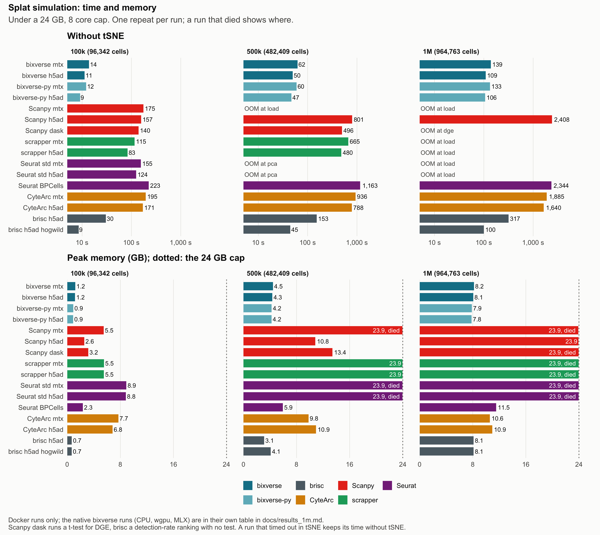

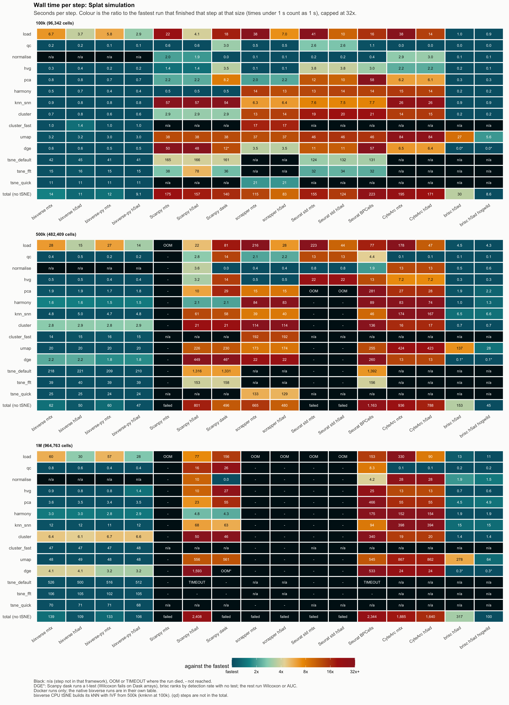

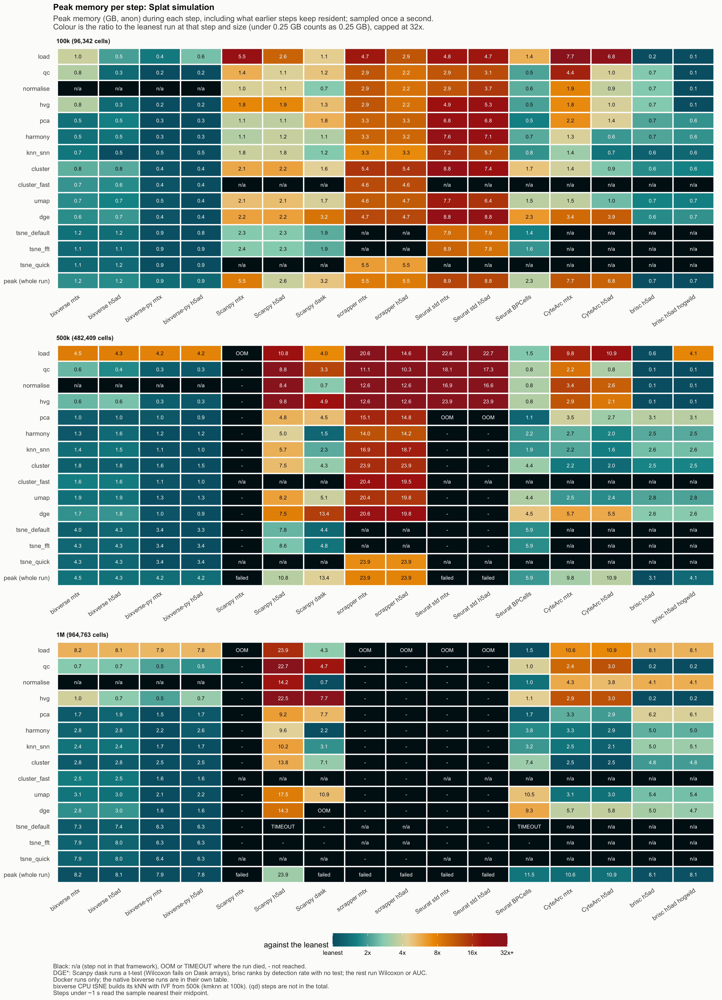

### 100k cells (96,342 after QC)

| step | bixverse mtx | bixverse h5ad | bixverse-py mtx | bixverse-py h5ad | Scanpy mtx | Scanpy h5ad | Scanpy dask | scrapper mtx | scrapper h5ad | Seurat std mtx | Seurat std h5ad | Seurat BPCells | CyteArc mtx | CyteArc h5ad | brisc h5ad | brisc h5ad hogwild |
|---|---|---|---|---|---|---|---|---|---|---|---|---|---|---|---|---|
| load | 6.7 | 3.7 | 5.8 | 2.9 | 21.5 | 4.1 | 17.9 | 37.9 | 7.0 | 40.6 | 10.1 | 15.6 | 38.4 | 13.9 | 1.0 | 0.9 |
| qc | 0.2 | 0.2 | 0.1 | 0.1 | 0.6 | 0.6 | 3.0 | 0.4 | 0.5 | 2.7 | 2.6 | 1.1 | 0.0 | 0.0 | 0.0 | 0.0 |
| normalise | n/a | n/a | n/a | n/a | 2.0 | 1.9 | 0.0 | 0.1 | 0.1 | 0.2 | 0.2 | 0.4 | 2.9 | 3.0 | 0.1 | 0.1 |
| hvg | 0.3 | 0.4 | 0.2 | 0.2 | 1.4 | 1.4 | 3.5 | 0.1 | 0.1 | 3.8 | 3.8 | 3.1 | 2.2 | 2.2 | 0.2 | 0.1 |
| pca | 0.8 | 0.8 | 0.7 | 0.7 | 2.2 | 2.2 | 8.2 | 2.0 | 2.2 | 11.6 | 10.2 | 58.2 | 6.2 | 6.1 | 0.3 | 0.3 |
| harmony | 0.5 | 0.7 | 0.4 | 0.4 | 0.5 | 0.5 | 0.5 | 14.5 | 12.6 | 13.2 | 13.6 | 13.8 | 14.6 | 13.8 | 0.2 | 0.2 |
| knn_snn | 0.9 | 0.8 | 0.8 | 0.8 | 56.8 | 56.8 | 53.8 | 6.4 | 6.4 | 7.6 | 7.5 | 7.7 | 25.8 | 26.1 | 0.9 | 0.9 |
| cluster | 0.7 | 0.8 | 0.6 | 0.6 | 2.8 | 2.9 | 2.9 | 13.4 | 14.0 | 18.5 | 19.5 | 20.7 | 14.4 | 14.8 | 0.2 | 0.2 |
| cluster_fast (qd) | 1.0 | 1.4 | 1.0 | 1.0 | n/a | n/a | n/a | 17.5 | 17.3 | n/a | n/a | n/a | n/a | n/a | n/a | n/a |
| umap | 3.2 | 3.3 | 3.0 | 3.0 | 37.5 | 37.9 | 37.6 | 37.0 | 37.1 | 45.5 | 45.8 | 45.7 | 84.2 | 84.2 | 27.2 | 5.6 |
| dge | 0.6 | 0.6 | 0.5 | 0.5 | 49.5 | 48.5 | 12.4 | 3.5 | 3.5 | 11.2 | 10.8 | 57.3 | 6.5 | 6.4 | 0.0 | 0.0 |
| tsne_default | 41.8 | 44.6 | 41.2 | 41.4 | 164.6 | 166.2 | 160.8 | n/a | n/a | 124.0 | 132.1 | 130.6 | n/a | n/a | n/a | n/a |
| tsne_fft | 15.4 | 16.0 | 15.0 | 14.7 | 38.2 | 77.9 | 36.3 | n/a | n/a | 32.1 | 33.9 | 32.4 | n/a | n/a | n/a | n/a |
| tsne_quick (qd) | 11.2 | 11.4 | 11.0 | 10.9 | n/a | n/a | n/a | 20.7 | 20.7 | n/a | n/a | n/a | n/a | n/a | n/a | n/a |
| **total** | **82** | **83** | **79** | **76** | **378** | **401** | **337** | **136** | **104** | **311** | **290** | **386** | **195** | **171** | **30** | **9** |
| total without tSNE | 14 | 11 | 12 | 9 | 175 | 157 | 140 | 115 | 83 | 155 | 124 | 223 | 195 | 171 | 30 | 9 |
| **peak GB** | **1.2** | **1.2** | **0.9** | **0.9** | **5.5** | **2.6** | **3.2** | **5.5** | **5.5** | **8.9** | **8.8** | **2.3** | **7.7** | **6.8** | **0.7** | **0.7** |
| peak swap GB | 0.0 | 0.0 | 0.0 | 0.0 | 0.0 | 0.0 | 0.0 | 0.0 | 0.0 | 0.0 | 0.0 | 0.0 | 0.0 | 0.0 | 0.0 | 0.0 |
| on-disk store GB | 0.3 | 0.3 | 0.3 | 0.3 | 0.0 | 0.0 | 0.0 | 0.0 | 0.0 | 0.0 | 0.0 | 1.2 | 0.8 | 0.8 | 0.0 | 0.0 |

### 500k cells (482,409 after QC)

| step | bixverse mtx | bixverse h5ad | bixverse-py mtx | bixverse-py h5ad | Scanpy mtx | Scanpy h5ad | Scanpy dask | scrapper mtx | scrapper h5ad | Seurat std mtx | Seurat std h5ad | Seurat BPCells | CyteArc mtx | CyteArc h5ad | brisc h5ad | brisc h5ad hogwild |
|---|---|---|---|---|---|---|---|---|---|---|---|---|---|---|---|---|
| load | 27.8 | 15.1 | 26.8 | 13.7 | **OOM** | 21.5 | 81.0 | 215.7 | 28.5 | 222.7 | 44.1 | 76.5 | 177.8 | 47.5 | 4.5 | 4.3 |
| qc | 0.4 | 0.4 | 0.2 | 0.2 | - | 2.8 | 13.5 | 2.1 | 2.2 | 12.8 | 12.5 | 4.4 | 0.0 | 0.0 | 0.0 | 0.1 |
| normalise | n/a | n/a | n/a | n/a | - | 3.6 | 0.0 | 0.4 | 0.4 | 0.8 | 0.8 | 2.0 | 13.0 | 13.0 | 0.5 | 0.5 |
| hvg | 0.5 | 0.5 | 0.4 | 0.4 | - | 3.2 | 14.2 | 0.5 | 0.5 | 22.5 | 22.5 | 12.6 | 7.2 | 7.2 | 0.3 | 0.3 |
| pca | 1.9 | 1.8 | 1.7 | 1.8 | - | 10.3 | 29.3 | 14.7 | 14.9 | **OOM** | **OOM** | 281.2 | 27.3 | 27.6 | 1.9 | 2.2 |
| harmony | 1.6 | 1.6 | 1.5 | 1.5 | - | 2.1 | 2.1 | 83.7 | 83.4 | - | - | 89.0 | 83.3 | 73.6 | 1.0 | 1.3 |
| knn_snn | 4.8 | 5.0 | 4.7 | 4.8 | - | 61.3 | 58.0 | 39.5 | 39.7 | - | - | 45.8 | 174.0 | 167.2 | 6.5 | 6.6 |
| cluster | 2.8 | 2.9 | 2.8 | 2.9 | - | 20.7 | 21.3 | 114.0 | 114.0 | - | - | 136.4 | 16.4 | 16.6 | 0.7 | 0.7 |
| cluster_fast (qd) | 14.2 | 15.1 | 15.7 | 15.2 | n/a | n/a | n/a | 192.4 | 192.4 | n/a | n/a | n/a | n/a | n/a | n/a | n/a |
| umap | 20.4 | 20.5 | 19.9 | 20.0 | - | 225.9 | 230.0 | 173.0 | 174.2 | - | - | 254.9 | 423.9 | 422.5 | 137.1 | 28.4 |
| dge | 2.2 | 2.2 | 1.8 | 1.8 | - | 449.0 | 46.4 | 21.9 | 22.4 | - | - | 260.4 | 13.4 | 13.3 | 0.1 | 0.1 |
| tsne_default | 217.6 | 220.7 | 208.9 | 210.0 | - | 1316.1 | 1331.3 | n/a | n/a | - | - | 1392.4 | n/a | n/a | n/a | n/a |
| tsne_fft | 39.5 | 39.8 | 39.1 | 39.2 | - | 152.9 | 158.0 | n/a | n/a | - | - | 155.9 | n/a | n/a | n/a | n/a |
| tsne_quick (qd) | 24.9 | 24.9 | 23.8 | 24.3 | n/a | n/a | n/a | 132.6 | 128.8 | n/a | n/a | n/a | n/a | n/a | n/a | n/a |
| **total** | **344** | **335** | **332** | **321** | failed | **2270** | **1985** | **798** | **609** | failed | failed | **2712** | **936** | **788** | **153** | **45** |
| total without tSNE | 62 | 50 | 60 | 47 | failed | 801 | 496 | 665 | 480 | failed | failed | 1163 | 936 | 788 | 153 | 45 |
| **peak GB** | **4.5** | **4.3** | **4.2** | **4.2** | **23.9** | **10.8** | **13.4** | **23.9** | **23.9** | **23.9** | **24.0** | **5.9** | **9.8** | **10.9** | **3.1** | **4.1** |
| peak swap GB | 0.0 | 0.0 | 0.0 | 0.0 | 4.0 | 0.0 | 0.0 | 1.3 | 1.4 | 3.7 | 4.0 | 0.0 | 0.0 | 0.0 | 0.0 | 0.0 |
| on-disk store GB | 1.4 | 1.4 | 1.4 | 1.4 | 0.0 | 0.0 | 0.0 | 0.0 | 0.0 | 0.0 | 0.0 | 6.2 | 4.1 | 4.1 | 0.0 | 0.0 |

### 1M cells (964,763 after QC)

| step | bixverse mtx | bixverse h5ad | bixverse-py mtx | bixverse-py h5ad | Scanpy mtx | Scanpy h5ad | Scanpy dask | scrapper mtx | scrapper h5ad | Seurat std mtx | Seurat std h5ad | Seurat BPCells | CyteArc mtx | CyteArc h5ad | brisc h5ad | brisc h5ad hogwild |
|---|---|---|---|---|---|---|---|---|---|---|---|---|---|---|---|---|
| load | 59.9 | 30.4 | 57.1 | 28.2 | **OOM** | 76.8 | 155.8 | **OOM** | **OOM** | **OOM** | **OOM** | 152.6 | 329.6 | 89.7 | 12.6 | 10.7 |
| qc | 0.8 | 0.6 | 0.4 | 0.4 | - | 15.7 | 26.1 | - | - | - | - | 8.3 | 0.1 | 0.1 | 0.2 | 0.2 |
| normalise | n/a | n/a | n/a | n/a | - | 10.2 | 0.0 | - | - | - | - | 4.2 | 27.7 | 27.8 | 1.9 | 1.5 |
| hvg | 0.9 | 0.8 | 0.8 | 1.4 | - | 10.3 | 26.8 | - | - | - | - | 24.8 | 12.9 | 12.9 | 0.7 | 0.6 |
| pca | 3.6 | 3.5 | 3.4 | 3.5 | - | 23.1 | 55.0 | - | - | - | - | 466.5 | 54.7 | 55.0 | 4.5 | 4.9 |
| harmony | 3.0 | 3.0 | 2.8 | 2.9 | - | 4.8 | 4.3 | - | - | - | - | 174.6 | 152.2 | 154.3 | 2.0 | 1.9 |
| knn_snn | 11.8 | 11.7 | 11.1 | 11.8 | - | 68.3 | 63.1 | - | - | - | - | 94.3 | 397.8 | 394.2 | 15.0 | 15.0 |
| cluster | 6.4 | 6.1 | 6.7 | 6.6 | - | 50.5 | 46.4 | - | - | - | - | 340.5 | 19.4 | 19.6 | 1.4 | 1.4 |
| cluster_fast (qd) | 46.6 | 47.3 | 47.1 | 48.3 | n/a | n/a | n/a | - | - | n/a | n/a | n/a | n/a | n/a | n/a | n/a |
| umap | 48.1 | 48.6 | 47.7 | 48.0 | - | 555.8 | 560.7 | - | - | - | - | 544.6 | 866.9 | 862.3 | 278.1 | 63.7 |
| dge | 4.1 | 4.1 | 3.2 | 3.2 | - | 1592.6 | **OOM** | - | - | - | - | 533.2 | 23.6 | 24.1 | 0.3 | 0.3 |
| tsne_default | 525.9 | 500.3 | 515.9 | 512.3 | - | **TIMEOUT** | - | n/a | n/a | - | - | **TIMEOUT** | n/a | n/a | n/a | n/a |
| tsne_fft | 105.5 | 104.9 | 101.6 | 105.1 | - | - | - | n/a | n/a | - | - | - | n/a | n/a | n/a | n/a |
| tsne_quick (qd) | 69.8 | 70.7 | 70.8 | 68.0 | n/a | n/a | n/a | - | - | n/a | n/a | n/a | n/a | n/a | n/a | n/a |
| **total** | **840** | **785** | **821** | **791** | failed | failed | failed | failed | failed | failed | failed | failed | **1885** | **1640** | **317** | **100** |
| total without tSNE | 139 | 109 | 133 | 106 | failed | 2408 | failed | failed | failed | failed | failed | 2344 | 1885 | 1640 | 317 | 100 |
| **peak GB** | **8.2** | **8.1** | **7.9** | **7.8** | **23.9** | **23.9** | **23.9** | **23.9** | **24.0** | **23.9** | **24.0** | **11.5** | **10.6** | **10.9** | **8.1** | **8.1** |
| peak swap GB | 0.0 | 0.0 | 0.0 | 0.0 | 3.8 | 2.5 | 3.6 | 4.0 | 3.8 | 4.0 | 3.8 | 0.0 | 0.0 | 0.0 | 0.0 | 0.0 |
| on-disk store GB | 2.7 | 2.7 | 2.7 | 2.7 | 0.0 | 0.0 | 0.0 | 0.0 | 0.0 | 0.0 | 0.0 | 12.5 | 8.3 | 8.3 | 0.0 | 0.0 |

### Quality

A parity check: do the fast paths give the answers the established frameworks
give? Every framework runs its own defaults on one seed of one simulator, so
the scores don't rank anything finer than that. The GPU and MLX rows are the
old native runs. Against the truth, h5ad paths, Scanpy dask and BPCells as
they are. Purity is the share of the 15 nearest neighbours in the same true
group; rare is the smallest group (about 1%, in 6 of 24 batches). (qd)
columns score `cluster_fast` at resolution 1. DGE R-precision is against
markers detectable in at least 10% of their group, and on the genes every tool
reported (shared). Scanpy dask has no scores at 1M: it OOMs in DGE, before the
score inputs are written. Definitions in [methods](methods.md#quality-scores).

#### 100k

| tool | clusters | ARI | NMI | rare F1 | ARI (qd) | rare F1 (qd) | HVG prec. | Harmony purity | rare purity | batch mix | UMAP purity | tSNE purity | tSNE (qd) purity | DGE R-prec. | DGE R-prec. shared |
|---|---|---|---|---|---|---|---|---|---|---|---|---|---|---|---|
| bixverse | 11 | 0.976 | 0.958 | 0.264 | 0.974 | 0.274 | 0.430 | 0.970 | 0.260 | 0.990 | 0.972 | 0.975 | 0.977 | 0.895 | 0.975 |
| bixverse-py | 11 | 0.976 | 0.958 | 0.264 | 0.869 | 0.274 | 0.430 | 0.970 | 0.260 | 0.990 | 0.972 | 0.975 | 0.977 | 0.895 | 0.975 |
| bixverse GPU (old stack) | 11 | 0.977 | 0.956 | 0.235 | 0.858 | 0.263 | 0.430 | 0.968 | 0.226 | 1.010 | 0.972 | 0.974 | 0.975 | 0.895 | 0.975 |
| bixverse MLX (old stack) | 11 | 0.974 | 0.955 | 0.218 | 0.857 | 0.262 | 0.430 | 0.967 | 0.222 | 1.011 | 0.970 | 0.973 | 0.974 | 0.895 | 0.975 |
| Scanpy | 11 | 0.853 | 0.854 | 0.089 | - | - | 0.390 | 0.908 | 0.130 | 0.993 | 0.916 | 0.922 | - | 0.927 | 0.881 |
| Scanpy dask | 10 | 0.895 | 0.874 | 0.048 | - | - | 0.390 | 0.908 | 0.130 | 0.993 | 0.916 | 0.922 | - | 0.924 | 0.956 |
| scrapper | 9 | 0.942 | 0.944 | 0.133 | 0.825 | 0.130 | 0.439 | 0.929 | 0.163 | 0.968 | 0.933 | - | 0.934 | 0.939 | 0.896 |
| Seurat std | 13 | 0.812 | 0.911 | 0.269 | - | - | 0.430 | 0.971 | 0.268 | 0.989 | 0.972 | 0.978 | - | 0.876 | 0.975 |
| Seurat BPCells | 13 | 0.788 | 0.907 | 0.270 | - | - | 0.430 | 0.971 | 0.268 | 0.989 | 0.972 | 0.978 | - | 0.876 | 0.975 |
| CyteArc | 10 | 0.954 | 0.925 | 0.144 | - | - | 0.366 | 0.949 | 0.120 | 0.972 | 0.954 | - | - | 0.927 | 0.881 |
| brisc | 11 | 0.977 | 0.959 | 0.277 | - | - | 0.430 | 0.974 | 0.343 | 0.982 | 0.977 | - | - | 0.291 | 0.984 |
| brisc hogwild | 11 | 0.977 | 0.959 | 0.277 | - | - | 0.430 | 0.974 | 0.343 | 0.982 | 0.978 | - | - | 0.291 | 0.984 |

#### 500k

| tool | clusters | ARI | NMI | rare F1 | ARI (qd) | rare F1 (qd) | HVG prec. | Harmony purity | rare purity | batch mix | UMAP purity | tSNE purity | tSNE (qd) purity | DGE R-prec. | DGE R-prec. shared |
|---|---|---|---|---|---|---|---|---|---|---|---|---|---|---|---|
| bixverse | 12 | 0.863 | 0.929 | 0.304 | 0.867 | 0.298 | 0.426 | 0.969 | 0.291 | 0.982 | 0.973 | 0.978 | 0.979 | 0.894 | 0.976 |
| bixverse-py | 12 | 0.869 | 0.930 | 0.297 | 0.871 | 0.297 | 0.426 | 0.969 | 0.291 | 0.982 | 0.972 | 0.978 | 0.979 | 0.894 | 0.976 |
| bixverse GPU (old stack) | 13 | 0.796 | 0.904 | 0.281 | 0.789 | 0.284 | 0.426 | 0.965 | 0.262 | 1.004 | 0.970 | 0.972 | 0.974 | 0.894 | 0.976 |
| bixverse MLX (old stack) | 12 | 0.869 | 0.928 | 0.307 | 0.807 | 0.284 | 0.426 | 0.967 | 0.268 | 1.004 | 0.971 | 0.975 | 0.976 | 0.894 | 0.976 |
| Scanpy | 10 | 0.904 | 0.868 | 0.110 | - | - | 0.398 | 0.894 | 0.131 | 0.984 | 0.909 | 0.916 | - | 0.934 | 0.883 |
| Scanpy dask | 11 | 0.836 | 0.838 | 0.113 | - | - | 0.398 | 0.894 | 0.131 | 0.984 | 0.906 | 0.916 | - | 0.928 | 0.957 |
| scrapper | 9 | 0.943 | 0.944 | 0.134 | 0.938 | 0.132 | 0.440 | 0.927 | 0.183 | 0.962 | 0.933 | - | 0.919 | 0.940 | 0.905 |
| Seurat BPCells | 15 | 0.702 | 0.878 | 0.315 | - | - | 0.428 | 0.970 | 0.309 | 0.981 | 0.972 | 0.980 | - | 0.694 | 0.966 |
| CyteArc | 10 | 0.962 | 0.937 | 0.169 | - | - | 0.393 | 0.954 | 0.159 | 0.970 | 0.960 | - | - | 0.934 | 0.883 |
| brisc | 19 | 0.979 | 0.960 | 0.344 | - | - | 0.427 | 0.974 | 0.401 | 0.975 | 0.981 | - | - | 0.321 | 0.987 |
| brisc hogwild | 19 | 0.979 | 0.960 | 0.344 | - | - | 0.427 | 0.974 | 0.401 | 0.975 | 0.981 | - | - | 0.321 | 0.987 |

#### 1M

| tool | clusters | ARI | NMI | rare F1 | ARI (qd) | rare F1 (qd) | HVG prec. | Harmony purity | rare purity | batch mix | UMAP purity | tSNE purity | tSNE (qd) purity | DGE R-prec. | DGE R-prec. shared |
|---|---|---|---|---|---|---|---|---|---|---|---|---|---|---|---|
| bixverse | 12 | 0.870 | 0.934 | 0.354 | 0.874 | 0.345 | 0.436 | 0.969 | 0.292 | 0.982 | 0.974 | 0.978 | 0.979 | 0.897 | 0.975 |
| bixverse-py | 12 | 0.867 | 0.933 | 0.354 | 0.868 | 0.347 | 0.436 | 0.969 | 0.292 | 0.982 | 0.974 | 0.978 | 0.979 | 0.897 | 0.975 |
| bixverse GPU (old stack) | 13 | 0.797 | 0.906 | 0.292 | 0.861 | 0.279 | 0.436 | 0.963 | 0.231 | 1.006 | 0.969 | 0.972 | 0.973 | 0.897 | 0.975 |
| bixverse MLX (old stack) | 12 | 0.867 | 0.929 | 0.302 | 0.862 | 0.291 | 0.436 | 0.965 | 0.237 | 1.005 | 0.970 | 0.973 | 0.974 | 0.897 | 0.975 |
| Scanpy | 12 | 0.831 | 0.829 | 0.105 | - | - | 0.396 | 0.889 | 0.118 | 0.986 | 0.904 | - | - | 0.934 | 0.879 |
| Seurat BPCells | 14 | 0.764 | 0.898 | 0.345 | - | - | 0.437 | 0.968 | 0.281 | 0.982 | 0.971 | - | - | 0.628 | 0.912 |
| CyteArc | 11 | 0.974 | 0.947 | 0.344 | - | - | 0.396 | 0.956 | 0.169 | 0.965 | 0.963 | - | - | 0.934 | 0.879 |
| brisc | 39 | 0.877 | 0.932 | 0.336 | - | - | 0.436 | 0.974 | 0.358 | 0.975 | 0.979 | - | - | 0.336 | 0.987 |
| brisc hogwild | 39 | 0.877 | 0.932 | 0.336 | - | - | 0.436 | 0.974 | 0.358 | 0.975 | 0.980 | - | - | 0.336 | 0.987 |

### Harmony on the same input (old stack)

Measured with bixverse 0.8.4 and bixverse.gpu 0.6.2; not rerun on 0.9.0.

bixverse's PCA (30 PCs) and the true batch labels for every
implementation, native, 8 threads, median of 3 runs. Extra GB is peak RSS over
a load-only run. kNN overlap is the share of the 15 nearest neighbours each
cell keeps against harmonypy; purity, rare purity and batch mix as in the
quality tables. The input PCA scores purity 0.964, rare purity 0.516 and batch
mix 0.156 at 1M (0.965, 0.487, 0.183 at 100k).

| implementation | 100k s | 1M s | 100k extra GB | 1M extra GB | kNN overlap 100k / 1M | purity 1M | rare purity 1M | batch mix 1M |
|---|---|---|---|---|---|---|---|---|
| bixverse v2 | **0.24** | 2.11 | 0.27 | 2.50 | 0.966 / 0.971 | 0.969 | 0.292 | 0.982 |
| bixverse v2, `block_size = 0.05` | 0.29 | 2.28 | 0.27 | 2.56 | 0.966 / 0.971 | 0.969 | 0.292 | 0.982 |
| bixverse GPU (wgpu) | 0.30 | 1.66 | 0.25 | 1.71 | 0.967 / 0.969 | 0.969 | 0.291 | 0.982 |
| bixverse MLX | 0.25 | **1.00** | 0.20 | 1.35 | 0.967 / 0.971 | 0.969 | 0.292 | 0.982 |
| bixverse v1 | 0.38 | 3.33 | 0.26 | 2.47 | 0.753 / 0.712 | 0.966 | 0.256 | 1.005 |
| harmonypy 2.1.0 | 0.44 | 4.16 | 0.15 | 1.44 | 1 / 1 | 0.968 | 0.282 | 0.982 |

Inside the current pipeline (Docker, bixverse 0.9.0) `harmony_sc` takes 0.7 s
at 100k, 1.6 s at 500k and 3.0 s at 1M; the gap to the standalone numbers is
the R wrapper plus the VM, not split further.

### What it shows

- **bixverse and brisc are in a league of their own.** From h5ad without
  tSNE: bixverse 11, 50 and 109 s (bixverse-py 9, 47 and 106 s), brisc with
  its Hogwild UMAP 9, 45 and 100 s. Next come scrapper (83 and 480 s, OOM at
  1M), Scanpy (157, 801 and 2,408 s) and CyteArc (171, 788 and 1,640 s).
  bixverse is 14x to 22x faster than in-memory Scanpy and 7x to 10x faster
  than scrapper, at a fifth of scrapper's memory at 500k (4.3 against
  23.9 GB).
- **brisc gets there in memory, bixverse out of core.** Their totals are level;
  how they get there differs. brisc loads in 4.5 s at 500k against bixverse's
  15 s (which writes its store and the CSC copy), and its Leiden and DGE take
  under a second. bixverse wins UMAP (20 s against 28 s for Hogwild and 137 s
  for brisc's default single-threaded optimiser) and the kNN. Without Hogwild
  brisc takes 3x as long (153 and 317 s).
- **At 1M Scanpy and scrapper run out of road.** scrapper OOMs at load on
  both inputs, Seurat standard already OOMs in PCA at 500k. In-memory Scanpy
  from h5ad gets to the end of DGE at the 24 GB cap with 2.5 GB swap and then
  times out in tSNE. Scanpy dask OOMs in its t-test DGE. bixverse peaks at
  8.1 GB, brisc at 8.1 GB, CyteArc at 10.9 GB and BPCells at 11.5 GB.
- **Quality: a parity check, and brisc scores best.** bixverse lands within
  the spread of the established frameworks: Harmony purity 0.969 to 0.970
  (others 0.889 to 0.974), ARI 0.86 to 0.98, DGE R-precision on the shared
  genes 0.975, level with Seurat's presto. brisc has the cleanest Harmony
  embedding (purity 0.974) and keeps the most of the rare group (rare purity
  0.34 to 0.40 against 0.29 for bixverse), but its DGE ranks detectable
  markers poorly (0.29 to 0.34 against 0.88 to 0.94), since it is not a test.
  bixverse-py scores like bixverse in R: same Rust.
- **The rare group is hard for everyone.** Rare F1 0.05 to 0.35; the
  best-matching cluster is still mostly other cells.
- **Cluster counts move.** brisc's sNN fragments: 19 clusters at 500k and 39
  at 1M against 12 true groups. Its ARI stays high at 500k (0.98) since the
  fragments sit inside true groups, and drops at 1M (0.88).
- **DGE: bixverse in seconds with a proper test.** 0.5 to 4.1 s for the
  Wilcoxon, against 3.5 to 22 s for scrapper (AUC), 6 to 24 s for CyteArc,
  57 to 533 s for BPCells and 49 to 1,593 s for in-memory Scanpy. Scanpy
  dask's t-test takes 12 and 46 s. brisc's 0.0 to 0.3 s is no test.
- **Scanpy's kNN got slower.** 54 to 68 s at every size, against 26 to 39 s
  on the previous stack: Scanpy 1.12.5 comes with pynndescent 0.7.0 and numba
  0.68.1. Left as installed.
- **tSNE: bixverse on the CPU is 2x to 6x faster in every category.** Standard
  Barnes-Hut at 500k: 221 s against 1,316 s for Scanpy and 1,392 s for
  BPCells, both of which time out at 1M. FFT: 40 s against 153 to 158 s.
  Quick and dirty: 25 s against scrapper's 129 to 133 s. From 500k bixverse's
  CPU tSNE uses an approximate kNN where Scanpy's and Seurat's default
  Barnes-Hut pay for an exact one ([methods](methods.md#workflow)).
- **bixverse's peak is set at load.** 8.1 to 8.2 GB at 1M, while the store and
  the CSC copy get written; every later step, tSNE included, stays below.
- **`cluster_fast` does not pay off on the CPU here.** 15 s against 3 s of
  Leiden at 500k and 47 s against 6 s at 1M for bixverse, 192 s against 114 s
  for scrapper.
- **Disk: bixverse's store is the smallest.** 0.3, 1.4 and 2.7 GB, against
  0.8, 4.1 and 8.3 GB for CyteArc (counts cell- and gene-major) and 1.2, 6.2
  and 12.5 GB for BPCells (including the gene-major copy its DGE writes).

## PBMC

Parse 1M PBMC and random subsamples, the same stack as the simulation. On PBMC
the DGE groups are the 24 samples.

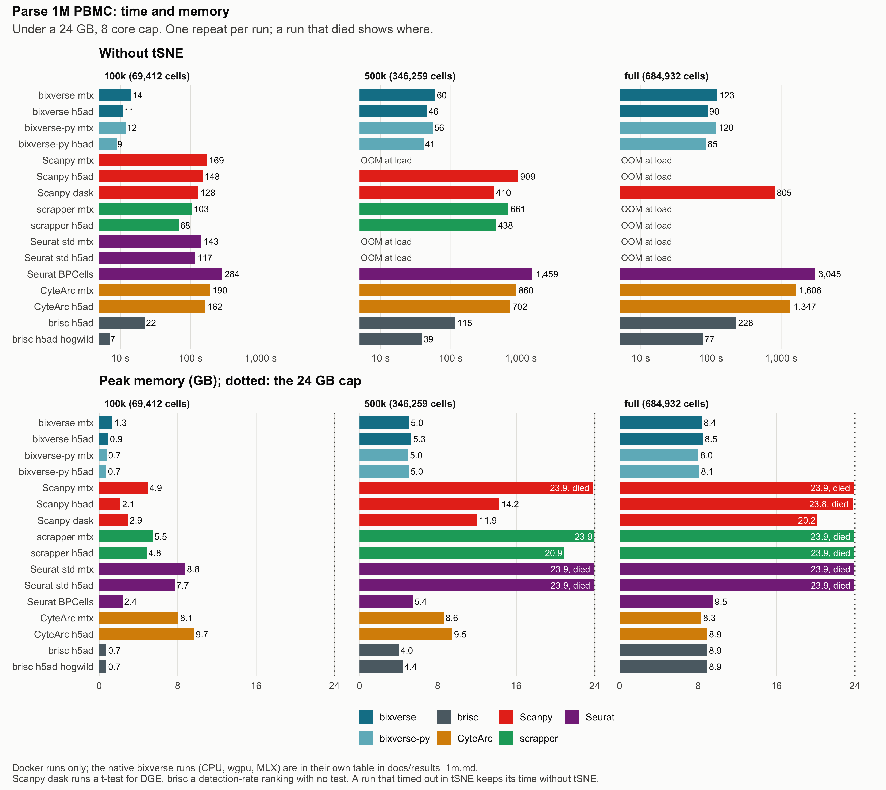

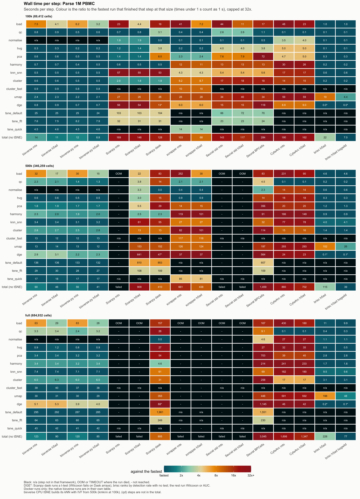

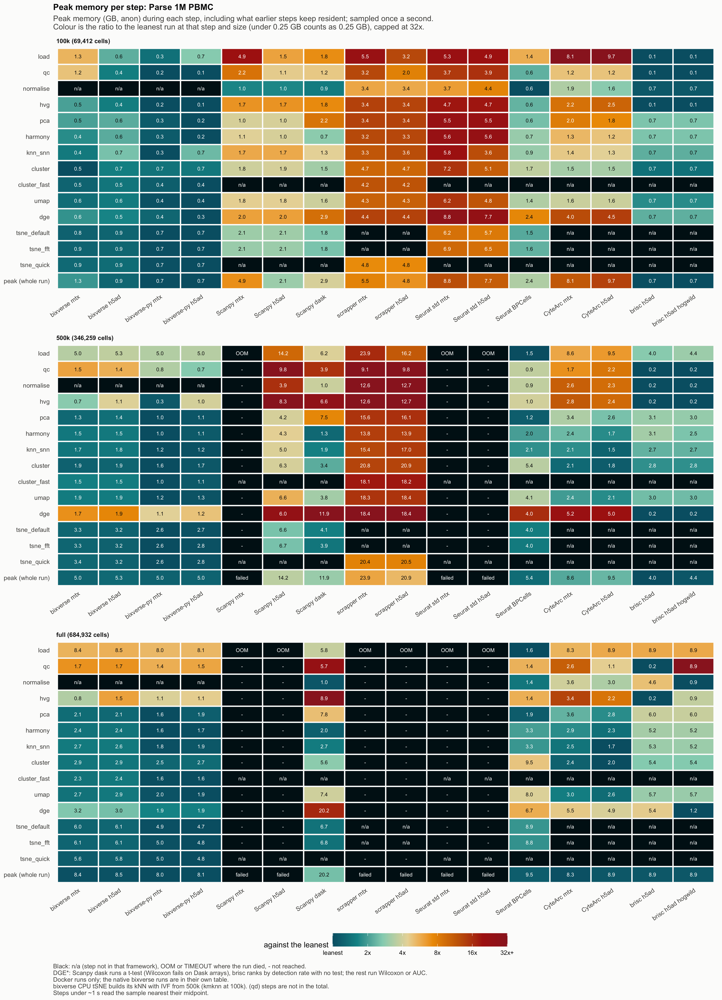

### 100k cells (69,412 after QC)

| step | bixverse mtx | bixverse h5ad | bixverse-py mtx | bixverse-py h5ad | Scanpy mtx | Scanpy h5ad | Scanpy dask | scrapper mtx | scrapper h5ad | Seurat std mtx | Seurat std h5ad | Seurat BPCells | CyteArc mtx | CyteArc h5ad | brisc h5ad | brisc h5ad hogwild |
|---|---|---|---|---|---|---|---|---|---|---|---|---|---|---|---|---|
| load | 7.5 | 4.1 | 6.2 | 3.2 | 22.9 | 4.4 | 18.4 | 40.6 | 7.2 | 43.9 | 10.7 | 16.9 | 47.6 | 23.0 | 1.0 | 1.0 |
| qc | 0.8 | 0.9 | 0.5 | 0.6 | 0.7 | 0.7 | 3.1 | 0.4 | 0.4 | 2.6 | 2.6 | 1.1 | 0.1 | 0.1 | 0.1 | 0.1 |
| normalise | n/a | n/a | n/a | n/a | 2.0 | 1.9 | 0.0 | 0.1 | 0.1 | 0.1 | 0.1 | 0.5 | 3.4 | 4.0 | 0.1 | 0.1 |
| hvg | 0.3 | 0.3 | 0.2 | 0.2 | 1.3 | 1.4 | 3.8 | 0.2 | 0.2 | 3.9 | 4.0 | 3.7 | 5.0 | 5.0 | 0.1 | 0.1 |
| pca | 0.6 | 0.6 | 0.5 | 0.5 | 1.4 | 1.4 | 8.0 | 2.3 | 2.4 | 7.6 | 7.9 | 72.5 | 4.7 | 5.0 | 0.3 | 0.3 |
| harmony | 0.7 | 0.7 | 0.4 | 0.5 | 0.5 | 0.5 | 0.5 | 12.2 | 11.0 | 13.0 | 13.3 | 13.1 | 30.4 | 25.8 | 0.2 | 0.2 |
| knn_snn | 0.5 | 0.5 | 0.5 | 0.5 | 56.5 | 55.4 | 53.3 | 4.3 | 4.3 | 5.4 | 5.4 | 5.6 | 16.9 | 17.1 | 0.6 | 0.6 |
| cluster | 0.6 | 0.6 | 0.5 | 0.5 | 2.0 | 1.8 | 2.0 | 9.2 | 8.7 | 17.1 | 17.9 | 18.2 | 14.4 | 14.5 | 0.2 | 0.2 |
| cluster_fast (qd) | 1.0 | 0.9 | 0.7 | 0.8 | n/a | n/a | n/a | 10.4 | 10.2 | n/a | n/a | n/a | n/a | n/a | n/a | n/a |
| umap | 2.4 | 2.3 | 2.2 | 2.1 | 26.7 | 26.4 | 26.3 | 27.8 | 27.9 | 34.2 | 39.8 | 34.5 | 58.7 | 58.8 | 19.4 | 4.4 |
| dge | 0.7 | 0.9 | 0.7 | 0.7 | 55.5 | 54.2 | 12.7 | 6.0 | 6.0 | 14.8 | 14.9 | 117.8 | 8.9 | 9.0 | 0.0 | 0.0 |
| tsne_default | 24.9 | 24.7 | 24.7 | 24.4 | 103.0 | 103.1 | 104.1 | n/a | n/a | 66.0 | 71.8 | 70.3 | n/a | n/a | n/a | n/a |
| tsne_fft | 7.6 | 7.5 | 8.2 | 7.9 | 31.7 | 30.5 | 31.4 | n/a | n/a | 23.2 | 23.1 | 24.0 | n/a | n/a | n/a | n/a |
| tsne_quick (qd) | 4.5 | 4.6 | 4.5 | 4.6 | n/a | n/a | n/a | 14.1 | 13.6 | n/a | n/a | n/a | n/a | n/a | n/a | n/a |
| **total** | **51** | **48** | **49** | **46** | **304** | **282** | **264** | **117** | **82** | **232** | **212** | **378** | **190** | **162** | **22** | **7** |
| total without tSNE | 14 | 11 | 12 | 9 | 169 | 148 | 128 | 103 | 68 | 143 | 117 | 284 | 190 | 162 | 22 | 7 |
| **peak GB** | **1.3** | **0.9** | **0.7** | **0.7** | **4.9** | **2.1** | **2.9** | **5.5** | **4.8** | **8.8** | **7.7** | **2.4** | **8.1** | **9.7** | **0.7** | **0.7** |
| peak swap GB | 0.0 | 0.0 | 0.0 | 0.0 | 0.0 | 0.0 | 0.0 | 0.0 | 0.0 | 0.0 | 0.0 | 0.0 | 0.0 | 0.0 | 0.0 | 0.0 |
| on-disk store GB | 0.3 | 0.3 | 0.3 | 0.3 | 0.0 | 0.0 | 0.0 | 0.0 | 0.0 | 0.0 | 0.0 | 1.2 | 0.8 | 0.8 | 0.0 | 0.0 |

### 500k cells (346,259 after QC)

| step | bixverse mtx | bixverse h5ad | bixverse-py mtx | bixverse-py h5ad | Scanpy mtx | Scanpy h5ad | Scanpy dask | scrapper mtx | scrapper h5ad | Seurat std mtx | Seurat std h5ad | Seurat BPCells | CyteArc mtx | CyteArc h5ad | brisc h5ad | brisc h5ad hogwild |
|---|---|---|---|---|---|---|---|---|---|---|---|---|---|---|---|---|
| load | 31.6 | 16.6 | 29.6 | 14.7 | **OOM** | 22.5 | 82.6 | 252.1 | 30.2 | **OOM** | **OOM** | 82.7 | 231.2 | 89.8 | 4.6 | 4.6 |
| qc | 2.3 | 2.1 | 1.4 | 1.3 | - | 3.7 | 13.8 | 2.1 | 2.2 | - | - | 4.6 | 0.1 | 0.1 | 0.2 | 0.2 |
| normalise | n/a | n/a | n/a | n/a | - | 3.3 | 0.0 | 0.4 | 0.4 | - | - | 2.3 | 14.3 | 14.2 | 0.6 | 0.6 |
| hvg | 0.6 | 0.6 | 0.5 | 0.5 | - | 3.0 | 14.7 | 0.9 | 0.9 | - | - | 14.3 | 18.2 | 18.2 | 0.3 | 0.3 |
| pca | 1.8 | 1.9 | 1.7 | 1.7 | - | 5.5 | 29.2 | 14.2 | 14.5 | - | - | 356.1 | 20.1 | 20.2 | 1.2 | 1.3 |
| harmony | 2.3 | 2.0 | 1.9 | 2.0 | - | 2.5 | 2.3 | 119.4 | 101.2 | - | - | 91.5 | 166.0 | 149.2 | 0.9 | 0.9 |
| knn_snn | 3.4 | 3.4 | 3.1 | 3.2 | - | 61.3 | 55.3 | 27.0 | 27.0 | - | - | 32.4 | 77.5 | 77.8 | 4.0 | 4.1 |
| cluster | 2.8 | 2.7 | 2.5 | 2.8 | - | 13.1 | 13.5 | 81.7 | 100.7 | - | - | 113.8 | 15.3 | 15.6 | 1.4 | 1.4 |
| cluster_fast (qd) | 12.7 | 12.1 | 12.5 | 13.4 | n/a | n/a | n/a | 116.5 | 116.0 | n/a | n/a | n/a | n/a | n/a | n/a | n/a |
| umap | 12.7 | 13.6 | 12.5 | 12.3 | - | 153.1 | 151.7 | 126.3 | 124.4 | - | - | 197.5 | 293.0 | 293.0 | 101.5 | 25.7 |
| dge | 2.9 | 3.1 | 2.2 | 2.3 | - | 641.1 | 47.1 | 36.6 | 37.0 | - | - | 563.7 | 23.9 | 23.4 | 0.1 | 0.1 |
| tsne_default | 135.5 | 136.1 | 132.6 | 132.0 | - | 810.4 | 852.7 | n/a | n/a | - | - | 607.3 | n/a | n/a | n/a | n/a |
| tsne_fft | 29.2 | 29.9 | 27.8 | 27.3 | - | 108.0 | 108.6 | n/a | n/a | - | - | 109.0 | n/a | n/a | n/a | n/a |
| tsne_quick (qd) | 17.5 | 18.5 | 17.3 | 16.9 | n/a | n/a | n/a | 84.6 | 80.8 | n/a | n/a | n/a | n/a | n/a | n/a | n/a |
| **total** | **243** | **231** | **233** | **217** | failed | **1828** | **1371** | **745** | **519** | failed | failed | **2175** | **860** | **702** | **115** | **39** |
| total without tSNE | 60 | 46 | 55 | 41 | failed | 909 | 410 | 661 | 438 | failed | failed | 1459 | 860 | 702 | 115 | 39 |
| **peak GB** | **5.1** | **5.3** | **5.0** | **5.0** | **23.9** | **14.2** | **12.0** | **23.9** | **20.9** | **23.9** | **23.9** | **5.4** | **8.6** | **9.5** | **4.0** | **4.4** |
| peak swap GB | 0.0 | 0.0 | 0.0 | 0.0 | 3.9 | 0.0 | 0.0 | 3.3 | 0.0 | 4.0 | 4.0 | 0.0 | 0.0 | 0.0 | 0.0 | 0.0 |
| on-disk store GB | 1.3 | 1.3 | 1.3 | 1.3 | 0.0 | 0.0 | 0.0 | 0.0 | 0.0 | 0.0 | 0.0 | 5.8 | 3.9 | 3.9 | 0.0 | 0.0 |

### Full data set (684,932 after QC)

| step | bixverse mtx | bixverse h5ad | bixverse-py mtx | bixverse-py h5ad | Scanpy mtx | Scanpy h5ad | Scanpy dask | scrapper mtx | scrapper h5ad | Seurat std mtx | Seurat std h5ad | Seurat BPCells | CyteArc mtx | CyteArc h5ad | brisc h5ad | brisc h5ad hogwild |
|---|---|---|---|---|---|---|---|---|---|---|---|---|---|---|---|---|
| load | 63.1 | 29.3 | 62.9 | 28.2 | **OOM** | **OOM** | 157.1 | **OOM** | **OOM** | **OOM** | **OOM** | 167.1 | 429.8 | 180.4 | 10.6 | 9.9 |
| qc | 3.3 | 3.4 | 2.4 | 3.2 | - | - | 26.3 | - | - | - | - | 9.1 | 0.1 | 0.1 | 0.4 | 0.3 |
| normalise | n/a | n/a | n/a | n/a | - | - | 0.0 | - | - | - | - | 4.6 | 26.7 | 27.5 | 1.1 | 1.1 |
| hvg | 0.9 | 1.2 | 0.8 | 0.9 | - | - | 27.2 | - | - | - | - | 27.2 | 32.3 | 34.8 | 0.5 | 0.5 |
| pca | 3.4 | 3.4 | 3.2 | 3.2 | - | - | 54.5 | - | - | - | - | 702.8 | 38.8 | 39.7 | 2.8 | 2.8 |
| harmony | 3.4 | 3.4 | 3.2 | 3.4 | - | - | 4.6 | - | - | - | - | 213.6 | 241.4 | 232.6 | 1.7 | 1.8 |
| knn_snn | 7.4 | 7.4 | 7.1 | 7.1 | - | - | 60.6 | - | - | - | - | 69.4 | 182.5 | 180.2 | 9.5 | 9.6 |
| cluster | 6.0 | 6.3 | 6.0 | 6.0 | - | - | 31.3 | - | - | - | - | 257.5 | 17.0 | 17.5 | 3.1 | 3.1 |
| cluster_fast (qd) | 39.4 | 39.8 | 37.0 | 38.3 | n/a | n/a | n/a | - | - | n/a | n/a | n/a | n/a | n/a | n/a | n/a |
| umap | 30.3 | 30.7 | 30.2 | 29.5 | - | - | 355.3 | - | - | - | - | 447.7 | 591.4 | 592.0 | 197.7 | 48.3 |
| dge | 5.1 | 5.3 | 3.9 | 4.0 | - | - | 88.1 | - | - | - | - | 1145.5 | 45.6 | 42.1 | 0.2 | 0.1 |
| tsne_default | 295.0 | 292.4 | 286.7 | 285.3 | - | - | 1960.8 | n/a | n/a | - | - | 1551.2 | n/a | n/a | n/a | n/a |
| tsne_fft | 63.7 | 63.4 | 60.2 | 64.7 | - | - | 249.0 | n/a | n/a | - | - | 230.4 | n/a | n/a | n/a | n/a |
| tsne_quick (qd) | 42.8 | 42.1 | 41.0 | 42.0 | n/a | n/a | n/a | - | - | n/a | n/a | n/a | n/a | n/a | n/a | n/a |
| **total** | **524** | **488** | **508** | **477** | failed | failed | **3015** | failed | failed | failed | failed | **4826** | **1606** | **1347** | **228** | **77** |
| total without tSNE | 123 | 90 | 120 | 85 | failed | failed | 805 | failed | failed | failed | failed | 3045 | 1606 | 1347 | 228 | 77 |
| **peak GB** | **8.4** | **8.5** | **8.0** | **8.1** | **23.9** | **23.8** | **20.2** | **23.9** | **24.0** | **23.9** | **24.0** | **9.5** | **8.3** | **8.9** | **8.9** | **8.9** |
| peak swap GB | 0.0 | 0.0 | 0.0 | 0.0 | 3.8 | 3.7 | 0.0 | 4.0 | 3.8 | 4.0 | 3.8 | 0.0 | 0.0 | 0.0 | 0.0 | 0.0 |
| on-disk store GB | 2.6 | 2.6 | 2.6 | 2.6 | 0.0 | 0.0 | 0.0 | 0.0 | 0.0 | 0.0 | 0.0 | 11.5 | 7.7 | 7.7 | 0.0 | 0.0 |

brisc keeps a few more cells than the rest (69,454, 346,448 and 685,299): its
MT cut is <= 5% where the others use < 5%.

### Warm start

Reconnecting to data a cold run already converted (`WARM=1 scripts/run.sh`),
load step only. Not part of the comparison, which starts from scratch every
time. bixverse reopens its store and the stored cell map, so its object holds
the post-QC cells; BPCells reopens the pre-filtered, pre-QC matrix and builds
the Seurat object; CyteArc reopens its store with every cell. Cold load s is
the mtx load step of the full cold run.

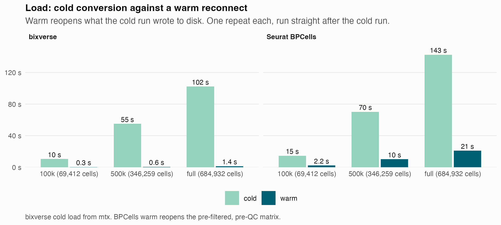

| data | framework | cold load s | warm load s | warm peak GB |
|---|---|---|---|---|
| PBMC 100k | bixverse | 7.5 | 0.4 | 0.2 |
| PBMC 100k | Seurat BPCells | 16.9 | 2.3 | 0.5 |
| PBMC 100k | CyteArc | 47.6 | 2.9 | 0.1 |
| PBMC 500k | bixverse | 31.6 | 0.5 | 0.4 |
| PBMC 500k | Seurat BPCells | 82.7 | 10.5 | 0.7 |
| PBMC 500k | CyteArc | 231.3 | 3.0 | 0.1 |
| PBMC full | bixverse | 63.1 | 0.8 | 0.5 |
| PBMC full | Seurat BPCells | 167.1 | 20.9 | 1.0 |
| PBMC full | CyteArc | 429.8 | 3.5 | 0.1 |

### What it shows

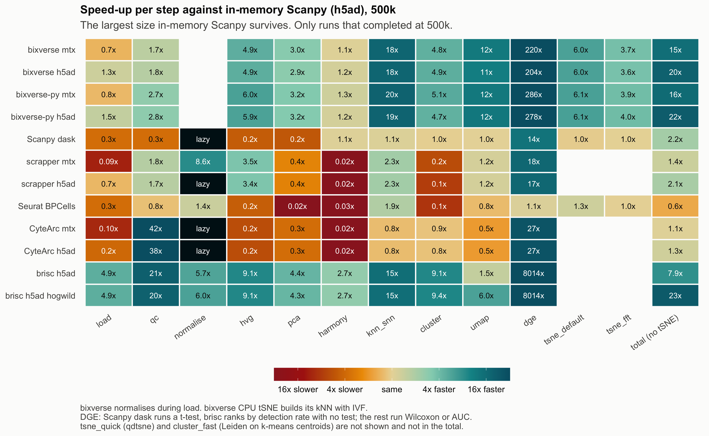

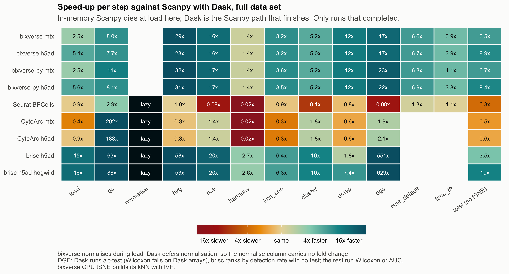

- **On real data brisc's Hogwild row is the fastest at every size.** 7, 39 and
  77 s without tSNE, against 9, 41 and 85 s for bixverse-py and 11, 46 and
  90 s for bixverse in R, both from h5ad. Same story as the simulation: brisc
  loads 3x faster and skips the DGE test, bixverse wins UMAP (30 s against
  48 s at full) and the kNN. bixverse peaks lower on the full data (8.1 to
  8.5 GB against 8.9 GB anon; 9.7 to 10.1 GB against 13.4 GB max RSS).
- **Everything else that holds the counts in memory dies.** Scanpy (both
  inputs), scrapper and Seurat standard OOM at load on the full data.
  The other out-of-core designs finish: Scanpy dask in 805 s (t-test DGE,
  peaking at 20.2 GB), CyteArc in 1,347 s from h5ad (1,606 s from mtx),
  Seurat + BPCells in 3,045 s.
- **Against in-memory Scanpy** at 500k, the largest size it survives: bixverse
  from h5ad is 20x faster without tSNE (46 s against 909 s) at about a third
  of the memory (5.3 GB against 14.2 GB). DGE is 641 s of Scanpy's 909 s.
- **Each out-of-core design pays somewhere.** bixverse pays up front to write
  its store (29 s from h5ad on the full data) and is fast after. Dask loads in
  157 s, then runs the stock in-memory UMAP (355 s). BPCells re-evaluates its
  lazy chain on every pass (PCA 703 s, UMAP 448 s) and its DGE takes 1,146 s,
  the transpose to gene-major included. CyteArc converts up front (180 s from
  h5ad, 430 s from mtx), then spends 592 s in UMAP and 233 s in Harmony.
- **scrapper survives 500k on swap.** The mtx row reaches the cap with 3.3 GB
  swap and finishes in 661 s; the h5ad row peaks at 20.9 GB without swap. Its
  mtx load is 252 s, nearly all of it `Matrix::readMM`.

## Native runs: CPU against GPU (old stack)

These predate the current stack: bixverse 0.8.4, bixverse.gpu 0.6.2,
manifoldsR 0.5.0, on the uncompressed inputs. They get rerun against
bixverse 0.9.0 next, together with the 10M runs.

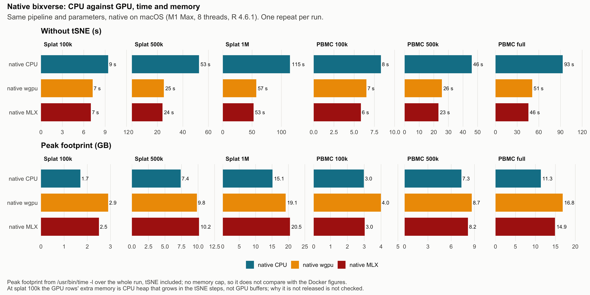

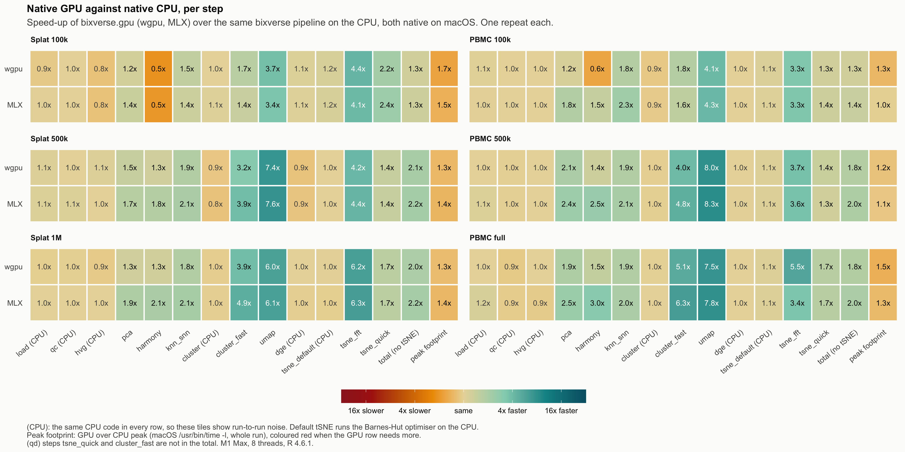

bixverse.gpu needs Metal, and Docker on macOS has no Metal access, so the wgpu
and MLX rows run natively (`scripts/run_native.sh`). Set against the Docker
rows that would mix the GPU in with the VM: native runs read the data without
the VM's file sharing and skip its overhead in the compute steps too. So the
GPU rows are compared against the same CPU pipeline run natively
(`BACKEND=cpu scripts/run_native.sh`), with the Docker run's parameters: 8
threads, nndescent for the sNN graph, kmknn for the tSNE kNN at 100k and IVF
from 500k.

Peak memory here is the macOS peak footprint from `/usr/bin/time -l`, without
a memory cap, so it doesn't compare with the Docker tables. It also depends on
the R build: on the same machine and macOS, the same bixverse.gpu 0.6.1 tSNE
code peaks at 2.0 GB at splat 100k under R 4.5.1 and at 4.2 GB rebuilt for
R 4.6.1. All runs here use R 4.6.1 on macOS 27.0.1 (M1 Max). GPU memory itself
stays flat; the growth is CPU heap.

Seconds without tSNE and peak footprint:

| run | splat 100k | splat 500k | splat 1M | PBMC 100k | PBMC 500k | PBMC full |
|---|---|---|---|---|---|---|
| native CPU | 9 s, 1.7 GB | 53 s, 7.4 GB | 115 s, 15.1 GB | 8 s, 3.0 GB | 46 s, 7.3 GB | 93 s, 11.3 GB |
| native wgpu | 7 s, 2.9 GB | 25 s, 9.8 GB | 57 s, 19.1 GB | 7 s, 4.0 GB | 26 s, 8.7 GB | 51 s, 16.8 GB |
| native MLX | 7 s, 2.5 GB | 24 s, 10.2 GB | 53 s, 20.5 GB | 6 s, 3.0 GB | 23 s, 8.2 GB | 46 s, 14.9 GB |

### splat 100k

| step | native CPU | native wgpu | native MLX |
|---|---|---|---|
| load | 2.6 | 2.8 | 2.5 |
| qc | 0.1 | 0.1 | 0.1 |
| hvg | 0.2 | 0.2 | 0.2 |
| pca | 0.7 | 0.5 | 0.5 |
| harmony | 0.4 | 0.9 | 0.8 |
| knn_snn | 1.5 | 1.0 | 1.1 |
| cluster | 0.6 | 0.5 | 0.5 |
| cluster_fast (qd) | 0.8 | 0.5 | 0.6 |
| umap | 3.0 | 0.8 | 0.9 |
| dge | 0.5 | 0.5 | 0.5 |
| tsne_default | 44.3 | 37.4 | 37.3 |
| tsne_fft | 13.0 | 2.9 | 3.2 |
| tsne_quick (qd) | 10.9 | 4.9 | 4.5 |
| **total** | **78** | **52** | **52** |
| total without tSNE | 9 | 7 | 7 |
| **peak footprint GB** | **1.7** | **2.9** | **2.5** |
| on-disk store GB | 0.3 | 0.3 | 0.3 |

### splat 500k

| step | native CPU | native wgpu | native MLX |
|---|---|---|---|
| load | 11.2 | 10.3 | 10.1 |
| qc | 0.3 | 0.3 | 0.3 |
| hvg | 0.4 | 0.4 | 0.4 |
| pca | 1.8 | 1.2 | 1.0 |
| harmony | 1.3 | 1.0 | 0.7 |
| knn_snn | 7.2 | 3.9 | 3.5 |
| cluster | 2.3 | 2.5 | 2.7 |
| cluster_fast (qd) | 9.5 | 3.0 | 2.4 |
| umap | 26.6 | 3.6 | 3.5 |
| dge | 1.6 | 1.9 | 1.8 |
| tsne_default | 239.1 | 237.6 | 236.8 |
| tsne_fft | 52.3 | 12.3 | 12.0 |
| tsne_quick (qd) | 42.9 | 29.7 | 29.9 |
| **total** | **387** | **305** | **303** |
| total without tSNE | 53 | 25 | 24 |
| **peak footprint GB** | **7.4** | **9.8** | **10.2** |
| on-disk store GB | 1.4 | 1.4 | 1.4 |

### splat 1M

| step | native CPU | native wgpu | native MLX |
|---|---|---|---|
| load | 23.6 | 24.4 | 22.7 |
| qc | 0.5 | 0.5 | 0.5 |
| hvg | 0.7 | 0.7 | 0.7 |
| pca | 3.9 | 2.9 | 2.0 |
| harmony | 2.3 | 1.8 | 1.1 |
| knn_snn | 15.3 | 8.3 | 7.2 |
| cluster | 5.1 | 5.3 | 5.3 |
| cluster_fast (qd) | 30.3 | 7.9 | 6.2 |
| umap | 60.1 | 10.0 | 9.8 |
| dge | 3.2 | 3.2 | 3.3 |
| tsne_default | 582.3 | 554.7 | 599.8 |
| tsne_fft | 174.4 | 28.2 | 27.8 |
| tsne_quick (qd) | 133.4 | 79.7 | 80.6 |
| **total** | **1005** | **720** | **761** |
| total without tSNE | 115 | 57 | 53 |
| **peak footprint GB** | **15.1** | **19.1** | **20.5** |
| on-disk store GB | 2.7 | 2.8 | 2.7 |

### PBMC 100k

| step | native CPU | native wgpu | native MLX |
|---|---|---|---|
| load | 3.0 | 2.8 | 2.9 |
| qc | 0.4 | 0.4 | 0.4 |
| hvg | 0.2 | 0.2 | 0.2 |
| pca | 0.4 | 0.3 | 0.2 |
| harmony | 0.5 | 0.8 | 0.3 |
| knn_snn | 0.8 | 0.5 | 0.4 |
| cluster | 0.4 | 0.5 | 0.5 |
| cluster_fast (qd) | 0.7 | 0.4 | 0.4 |
| umap | 2.0 | 0.5 | 0.5 |
| dge | 0.6 | 0.6 | 0.6 |
| tsne_default | 28.5 | 25.2 | 26.2 |
| tsne_fft | 6.7 | 2.1 | 2.0 |
| tsne_quick (qd) | 5.1 | 4.0 | 3.7 |
| **total** | **49** | **38** | **38** |
| total without tSNE | 8 | 7 | 6 |
| **peak footprint GB** | **3.0** | **4.0** | **3.0** |
| on-disk store GB | 0.3 | 0.3 | 0.3 |

### PBMC 500k

| step | native CPU | native wgpu | native MLX |
|---|---|---|---|
| load | 12.1 | 11.9 | 10.8 |
| qc | 1.3 | 1.3 | 1.3 |
| hvg | 0.6 | 0.6 | 0.6 |
| pca | 1.6 | 0.8 | 0.7 |
| harmony | 1.8 | 1.3 | 0.7 |
| knn_snn | 4.6 | 2.5 | 2.2 |
| cluster | 2.4 | 2.5 | 2.5 |
| cluster_fast (qd) | 7.8 | 1.9 | 1.6 |
| umap | 19.4 | 2.4 | 2.3 |
| dge | 2.3 | 2.3 | 2.2 |
| tsne_default | 156.7 | 142.5 | 142.2 |
| tsne_fft | 31.5 | 8.6 | 8.7 |
| tsne_quick (qd) | 27.0 | 19.3 | 20.6 |
| **total** | **261** | **196** | **195** |
| total without tSNE | 46 | 26 | 23 |
| **peak footprint GB** | **7.3** | **8.7** | **8.2** |
| on-disk store GB | 1.3 | 1.3 | 1.3 |

### PBMC full

| step | native CPU | native wgpu | native MLX |
|---|---|---|---|
| load | 24.1 | 23.5 | 20.4 |
| qc | 2.3 | 2.5 | 2.4 |
| hvg | 0.8 | 0.8 | 0.8 |
| pca | 3.6 | 1.8 | 1.5 |
| harmony | 3.2 | 2.1 | 1.1 |
| knn_snn | 10.0 | 5.4 | 4.9 |
| cluster | 5.3 | 5.3 | 5.2 |
| cluster_fast (qd) | 24.7 | 4.9 | 3.9 |
| umap | 39.6 | 5.3 | 5.0 |
| dge | 4.2 | 4.1 | 4.2 |
| tsne_default | 365.6 | 334.8 | 332.7 |
| tsne_fft | 104.0 | 18.8 | 30.6 |
| tsne_quick (qd) | 82.5 | 48.1 | 47.9 |
| **total** | **645** | **452** | **457** |
| total without tSNE | 93 | 51 | 46 |
| **peak footprint GB** | **11.3** | **16.8** | **14.9** |
| on-disk store GB | 2.6 | 2.6 | 2.6 |

### What it shows

- **The GPU pays off from 500k.** Without tSNE wgpu and MLX are 1.3x to
  1.4x faster than the native CPU at 100k and 1.8x to 2.2x from 500k
  (splat 1M: 115 s against 57 and 53 s).
- **UMAP is most of it.** 6x to 8x faster from 500k (splat 1M: 60 s against
  10 s), then the kNN (about 2x). PCA and Harmony gain 1.3x to 3x, but that's
  seconds at most; at 100k Harmony on wgpu is slower than on the CPU (0.9
  against 0.4 s at splat 100k). Leiden and DGE are the same CPU code in every
  row.
- **FFT tSNE is 3x to 6x faster on the GPU** (splat 1M: 174 s against 28 s).
  The default Barnes-Hut optimiser runs on the CPU in every row, so it barely
  moves (splat 1M: 582 s native CPU, 555 to 600 s on the GPU rows).
- **The GPU rows need more memory.** Peak footprint up to 1.7x the native
  CPU's (splat 1M: 15.1 GB against 19.1 and 20.5 GB). At splat 100k the extra
  arrives in the tSNE steps, as CPU heap rather than GPU buffers; the larger
  sizes are not split by step.
- **Docker costs bixverse 1.3x to 1.7x.** The same CPU pipeline runs that much
  faster natively without tSNE (splat 1M: 115 s against 178 s from mtx), most
  of it in load (24 s against 62 s) and the rest spread over the compute steps
  (UMAP 60 s against 77 s). The other frameworks likely pay a similar VM tax,
  but only bixverse was run both ways. On a Linux host without a VM it should
  be smaller; not measured.
